# CodeBreaker

**Binaries back to readable source — proven by running it.**

CodeBreaker takes a compiled program — a Windows DLL, a DOS tool, a device driver, an Xbox 360 game,
a Java program, an 8-bit cartridge — and gives back source code a person can read, change and build,
in the language it was first written in. Then it proves the source is right: it compiles it, runs
it beside the original in an emulator on the same inputs, and compares what both actually did.

A function only counts when it **compiles** and **behaves like the original**: the same calls with
the same arguments, the same return value, the same memory left behind, the same stack and
registers. Byte-identical output is never the goal; it is only used as a hint for which of several
correct sources is closest to what was originally written.

| Light | Dark |
|---|---|
| 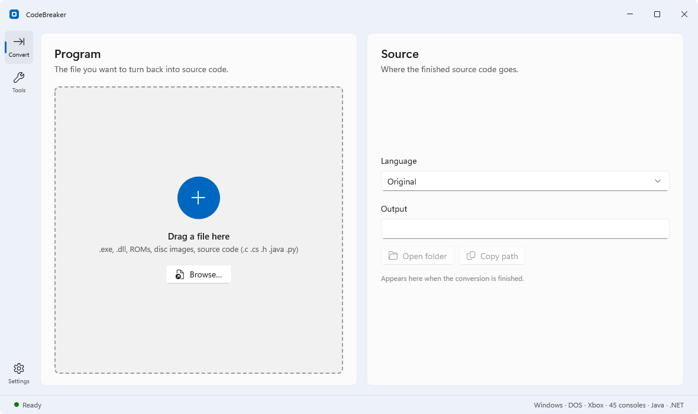 | 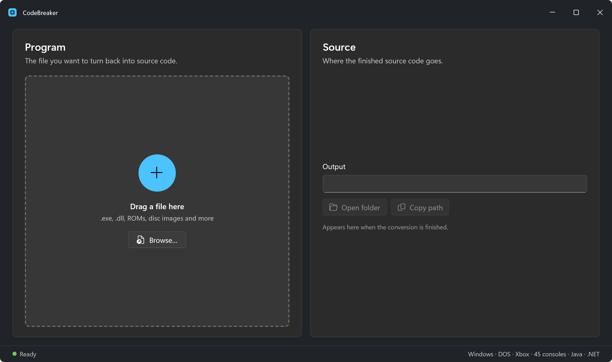 |

> **Version 2.1.0** — Settings for everyone, and the window grows: source preview, recent conversions, batches, drag the result out, a notification when it is done. CodeBreaker is one native C++20 program (`codebreaker.exe`): with no
> arguments it is a Windows 11 app, with arguments it is the command line. Every command runs natively, and there is no
> Python anywhere in it.

---

## Contents

- [What it handles](#what-it-handles)
- [See it work](#see-it-work)
- [How it works](#how-it-works)
- [System map](#system-map)
- [Architecture in depth](#architecture-in-depth)
- [The Windows 95 proof](#the-windows-95-proof)
- [Getting started](#getting-started)
- [Commands](#commands)
- [Repository layout](#repository-layout)
- [Testing](#testing)
- [Documentation](#documentation)
- [License](#license)

---

## What it handles

| Kind of code | Comes back as | Rebuilt | Checked by |
|---|---|---|---|
| 32-bit Windows modules, original Xbox (XBE) | C | per function, into a DLL | behaviour, beside the original |
| 16-bit Windows modules (NE) | C — or assembly, where it was written in assembly | per function, or the whole module | behaviour; Windows 95 boots and installs on them |
| VxD drivers, real-mode DOS programs | assembly source (DDK macros, MASM, NASM) | the whole file | byte for byte, and behaviour |
| Xbox 360 (XEX, packages, discs) | C per function; or the whole title as C++ that runs on a PC | per function / the whole game | behaviour; recompiled titles play |
| XNA games (.NET, Xbox 360 or PC) | C#, content as PNG / JSON / WAV, shaders as HLSL | a MonoGame project | builds and runs |
| Java programs | C++03 | per class | behaviour, beside the JVM |
| NES, Master System / Game Gear, Game Boy / Color, Genesis, ZX Spectrum, MSX | assembly source (ca65, WLA-DX, RGBDS, Motorola syntax, sjasmplus) | the whole cartridge or tape | byte for byte; functions run in CodeBreaker's own 6502 / Z80 / SM83 / 68000 |

Beyond reconstruction, the same engine is a **universal translator**: Java, Python and C# programs
go into one typed intermediate form (L2) and come out as C, C++17 or C++03.

`codebreaker reach <any file or folder>` says what CodeBreaker makes of anything you point it at
(discs and packages are opened). The real programs put through each lane are listed in
[docs/TESTED_SOFTWARE.md](docs/TESTED_SOFTWARE.md); the full platform map, including what is not
handled yet, is [docs/PLATFORMS.md](docs/PLATFORMS.md).

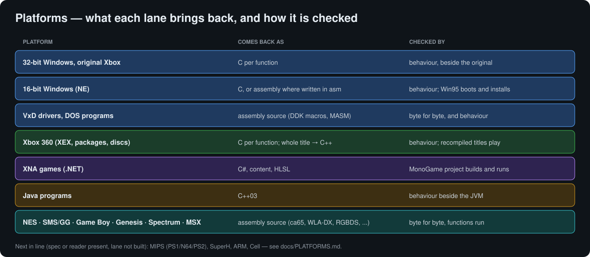

---

## See it work

**Drop a file, get its source code.** Run `codebreaker` with no arguments (or double-click it), drag a
program onto the window or press Browse, and the conversion runs with its real progress: the stage it
is in (identifying, unpacking, opening, disassembling, decompiling, writing the source), functions
decompiled of the total, files written of the total. When it finishes, the output folder is one click
away; a file CodeBreaker cannot convert is named for what it is (for example "This looks like a PNG
image") with a way to try another. The same pipeline runs on the command line as
`codebreaker convert FILE [--out DIR]`, which prints the stages and percentages.

| Working | Done | A file it cannot convert |
|---|---|---|
| 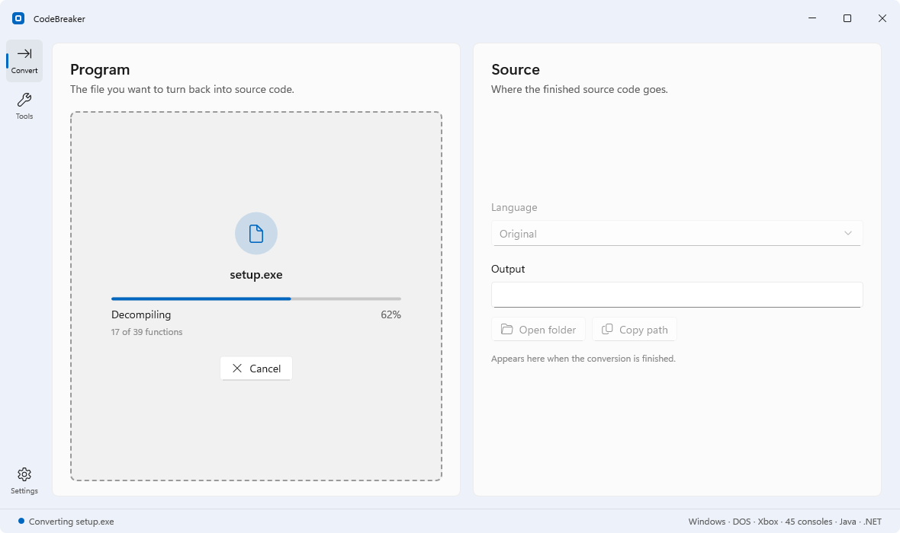 | 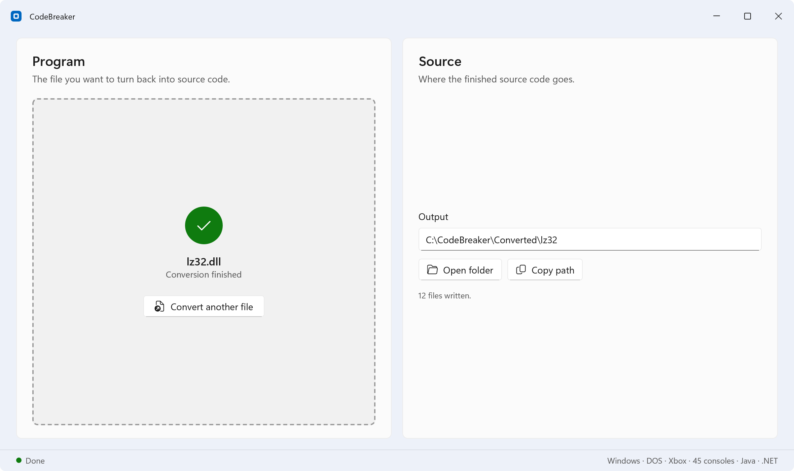 | 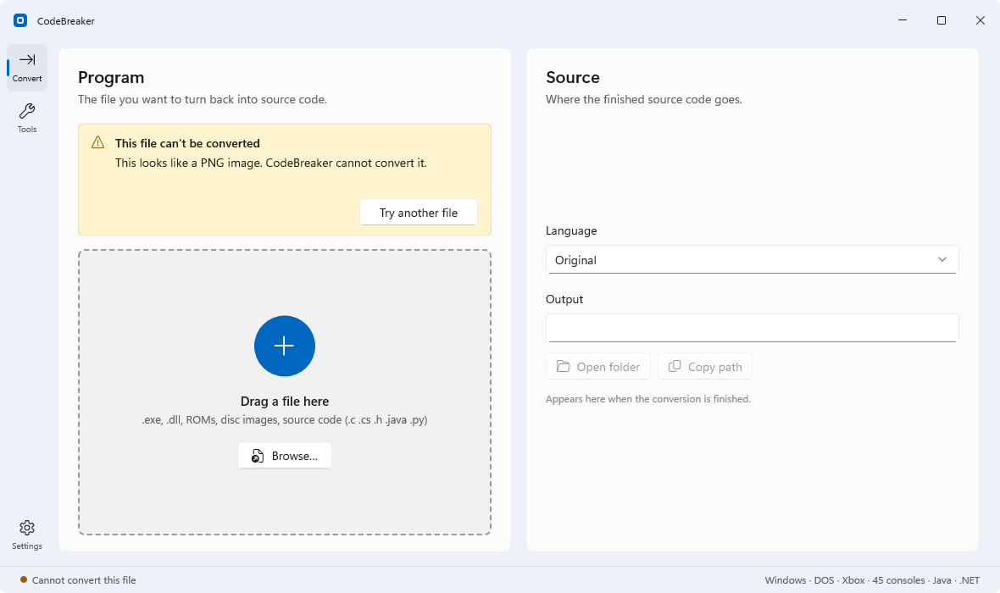 |

Which stages a file passes through depends on what it is: *Unpacking* only for containers (disc and disk
images, cabinets); *Decompiling* only where the source is C (Windows 32-bit and 16-bit programs, drivers,
DOS programs); console programs come back as assembly source. The window is plain Win32 with Direct2D
and DirectWrite (Mica backdrop, the system accent colour and light or dark theme, per-monitor DPI); the
screenshots above are drawn by it: `codebreaker app --screenshot OUT.png [--state idle|working|done|unsupported|failed|language|translating|tools|settings|recent|batch|preview|dragout|functions|check|compare|palette]
[--theme light|dark] [--size WxH] [--scale N]`.

**Several files, recent work, the source at a glance.** Drop several files (or choose several in the file dialog) and
they are converted one after another: the Program card lists the queue (a state icon, the file, the stage of the one
running, a bar and *Done*, a percentage, *Waiting* or *Can't convert*) with **Cancel all**, and files dropped during a run
join the end; when they have all finished the Source card shows the last one and every one is in **Recent**, the list under
the drop area of the last five conversions (what each became, how many files, when; a click reopens its Source card; one
whose folder has gone says so and offers Remove). The Source card lists the output folder's files, the main source first, and
shows the selected one, read-only, with simple colouring for C, C++, C# and assembly (wheel and arrow keys scroll, Ctrl+C copies
it; a long file shows its first 128 KB and says so). The output box is a drag source: drag the folder out of the window into
Explorer, VS Code or a USB drive. The taskbar button shows the progress of the run (red if it failed), and a conversion that
finishes while the window is not in front shows a Windows notification with *Open folder* and *Show* buttons (not when Windows
says not to disturb).

| Recent | Several files | Source preview | Drag the folder out |
|---|---|---|---|
| 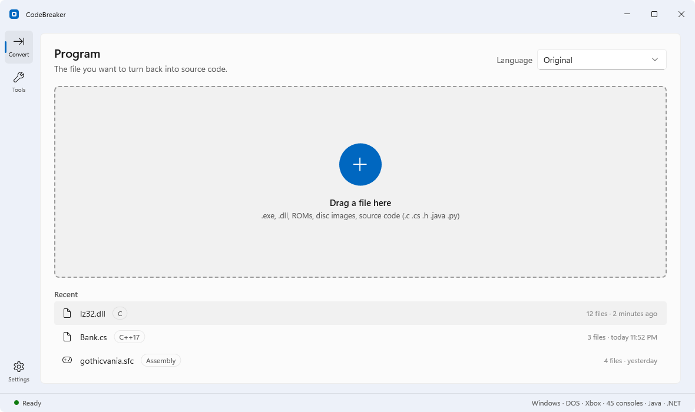 | 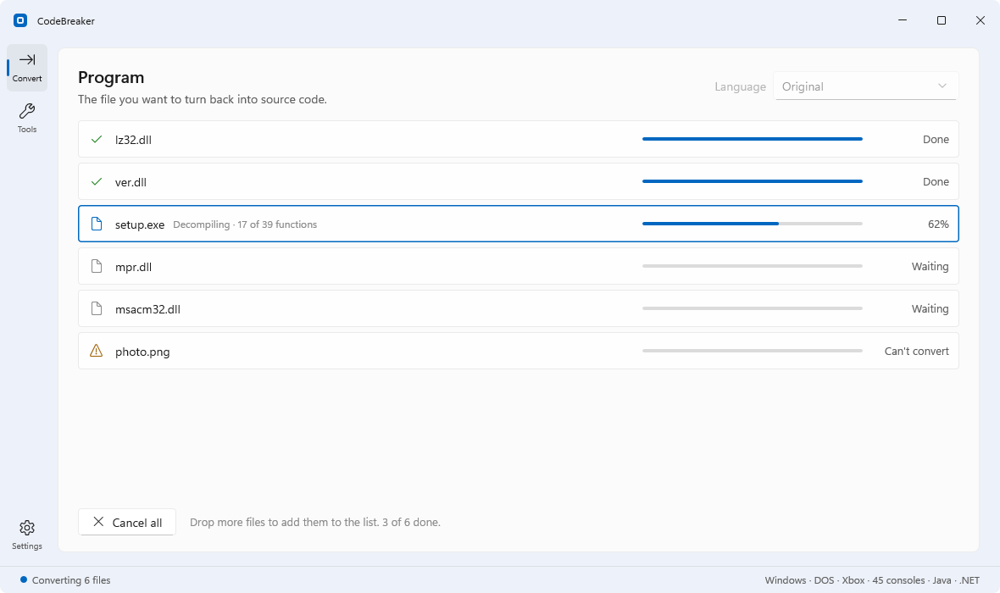 | 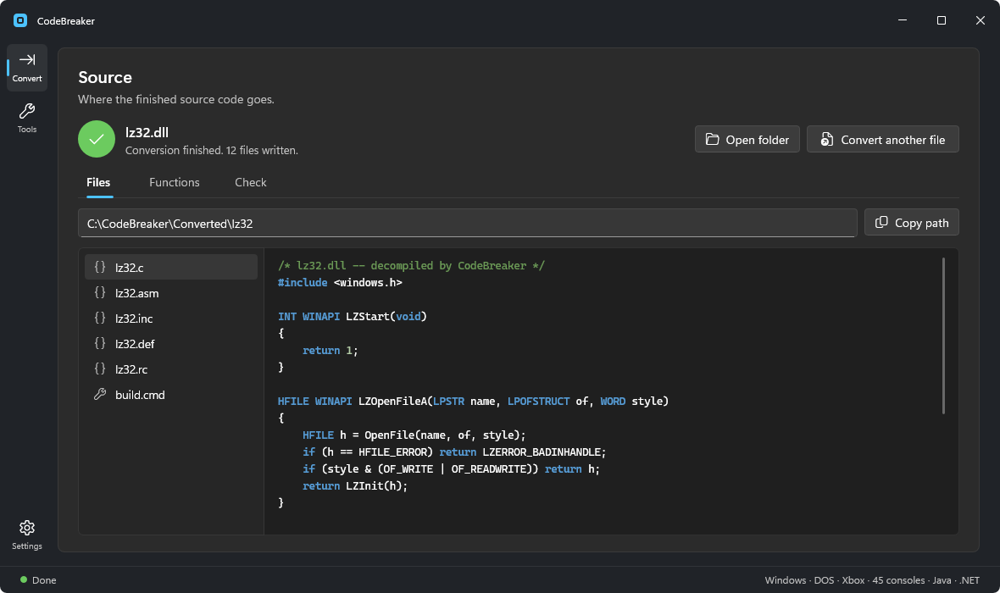 | 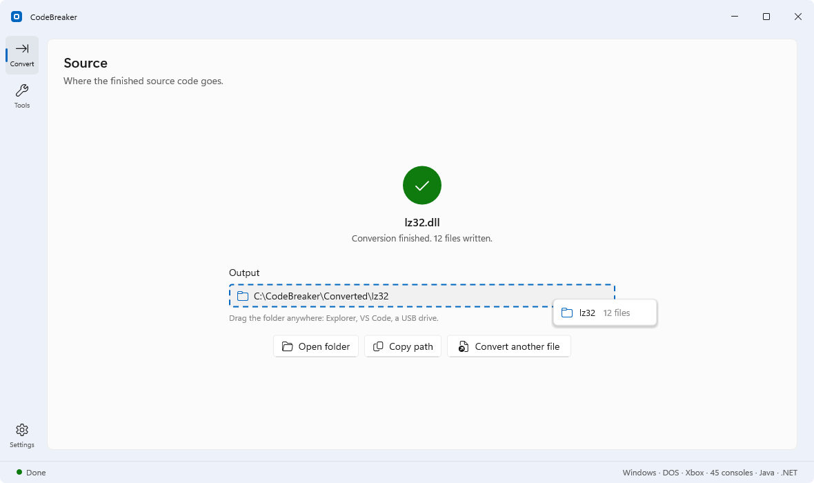 |

**Functions, Check, Compare and the command palette.** The finished Source card has three tabs. **Files** is the preview above.
**Functions** lists every function of the result with its address and a chip: *Behaves like the original*, *Differs* or *Not
checked*, under a segmented bar and "38 of 42 behave like the original" (the *Show* button cycles All, Differs, Not checked).
A function is *Not checked* unless something actually ran it: a route that judges each function records the verdict, and for a
Windows program the function store's latest verdicts are read; most routes do not judge, and the list says so rather than guess.
**Check** is the ring with the share that behaves alike and the three counts, with **Show what differs** (the list filtered to
Differs) and **Check again** (disabled, with the reason, until a route can judge again); with no verdicts it says "This
conversion was not checked by running it." instead of a 0% ring. Clicking a function opens **Compare**: its original
disassembly (from the output folder's `.asm`) beside its rebuilt source (from the `.c`), a function drop-down, **All
functions** to go back and the verdict chip; clicking a line lights the line it corresponds to (today, where a `call` by name
appears on both sides). **Ctrl+K** opens the command palette anywhere: type to filter the tools, the recent conversions and the
pages (Settings: Advanced is Ctrl+,), the arrow keys move, Enter runs, Esc closes.

| Functions | Check | Compare | Command palette |
|---|---|---|---|
| 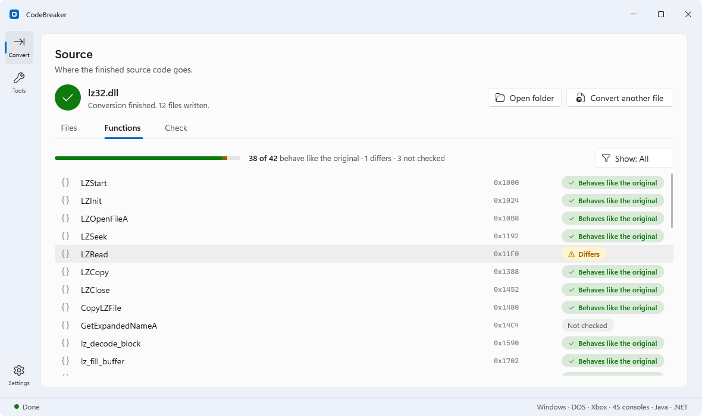 | 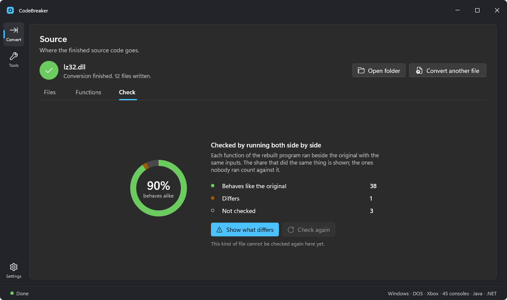 | 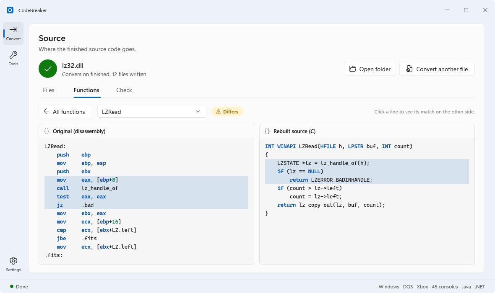 | 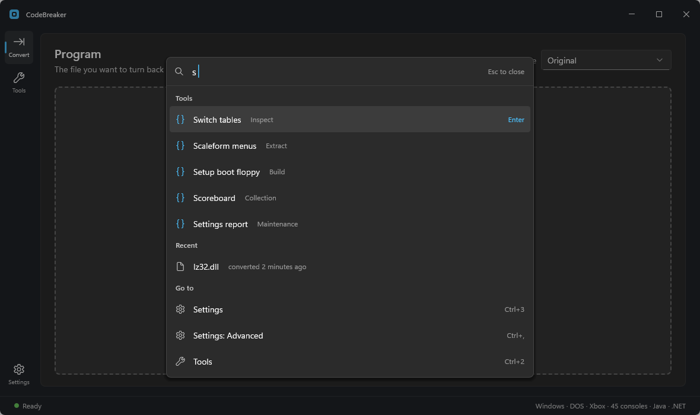 |

**Translate source code, and have it checked.** Drop a C# or Python file instead of a program and open the
**Language** drop-down above the Output box. It lists every language the translator knows; the ones it cannot
write for that file are greyed out with the reason underneath ("Python output is not supported yet", "C# to
Java is not supported yet"), and the list is asked of the translator, not written into the window. Choose
C++17 (C# and Python) or C# (the round trip) and the run adds two stages: *Translating* (functions written of
the total) and *Checking* (the translation is built and run beside the original, and what both print is
compared). The run is Done only when both agree; if they do not, or the translator cannot do the program
yet, it says so and keeps nothing. The choice is remembered. Alt+Down opens the list from the keyboard.
On the command line: `codebreaker convert Bank.cs --to cpp17`; `--languages` lists the choices for a file.

| Choosing a language | Translating |
|---|---|
| 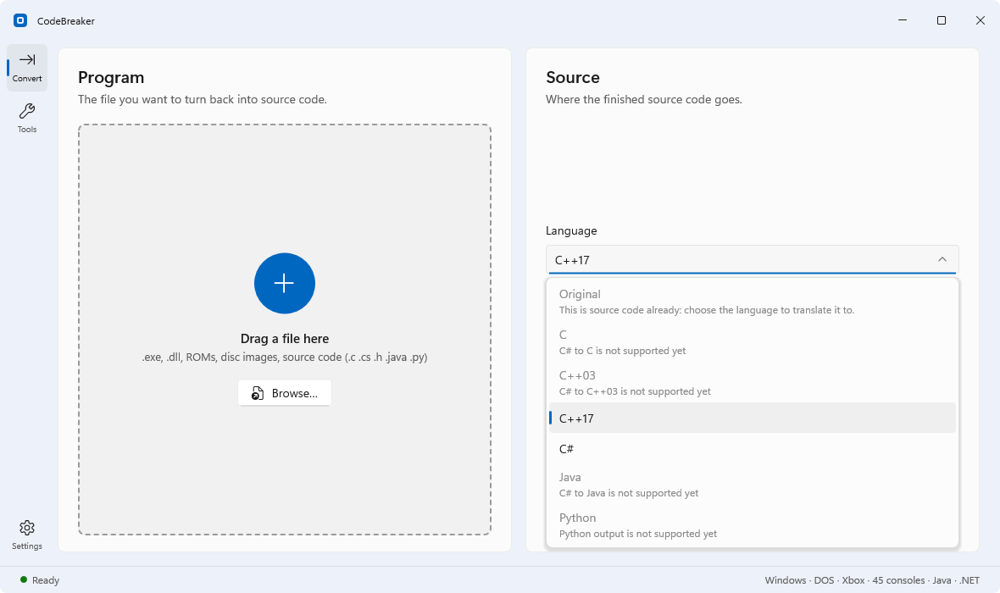 | 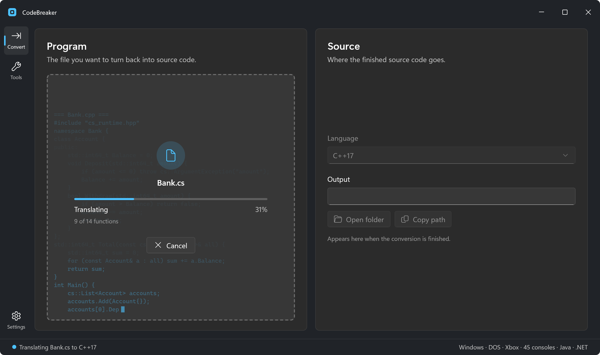 |

**Every command, from the window.** A navigation rail on the left (Convert, Tools, Settings; Ctrl+1, 2, 3) takes you
to the **Tools** page: every command in groups (Convert, Inspect, Extract, Build, Check, Compare, Collection,
Look up, Xbox 360, Maintenance), each with a plain-word title (*Windows program*, *Windows 3.x program*, *What is this file?*, *C# to C++*),
a search box that matches the title, the command's name and its description, and a form made from the command's
arguments: Browse buttons for files and folders, switches, drop-downs, lists, required fields marked, and Run
disabled until they are filled. Run starts the command as a child of the same program; its output streams into the
pane, the bar follows the percentages the command prints (a moving bar when it prints none), Stop ends that child, and
a run goes on if you go back to Convert (the rail's Tools item shows a dot). **Settings** edits `settings.json`
(paths with Browse, switches) and the theme (System, Light, Dark). The command line and `help` are unchanged.

| Tools | Settings |
|---|---|
| 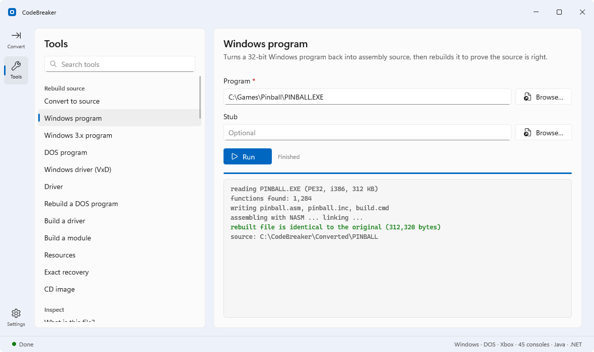 | 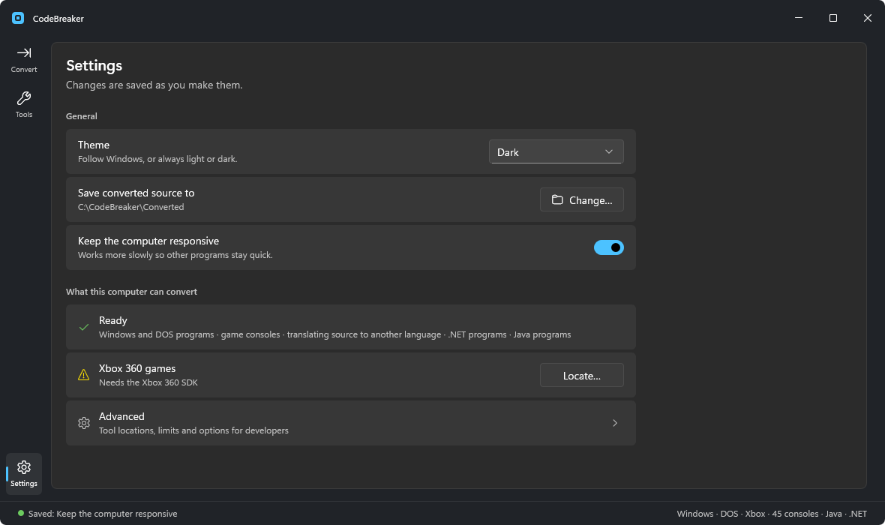 |

**A module, function by function.** `codebreaker decompile lzexpand.dll` writes each function's
recovered C, `codebreaker names`, `analyze` and `info` say what is in it, and `measure` and `module`
judge it. This is `lzexpand.dll` from Windows 95: 16-bit code coming back as C with its far pointers
intact.

**Windows 95 Setup, running on modules rebuilt from CodeBreaker's source.** These are screenshots
from the milestone regression run of 2026-11-14 — a real VM, booting and installing with every
reconstructed module in place:

| Setup starts | The license page | The wizard |
|---|---|---|
| 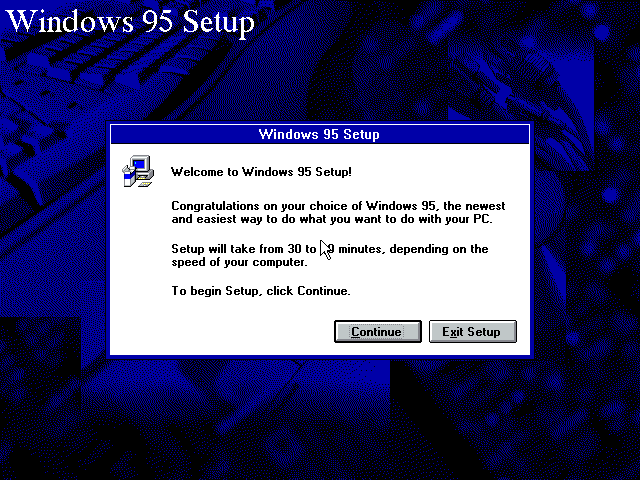 | 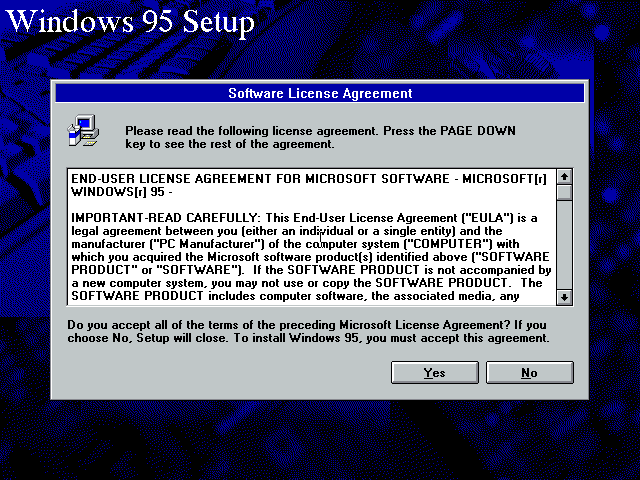 |  |

| Copying Windows | The desktop, installed |
|---|---|
| 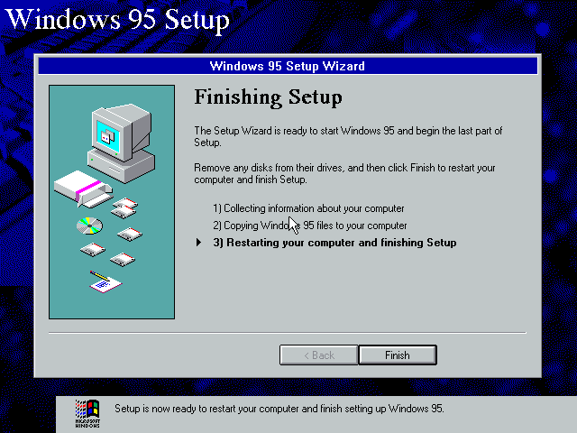 | 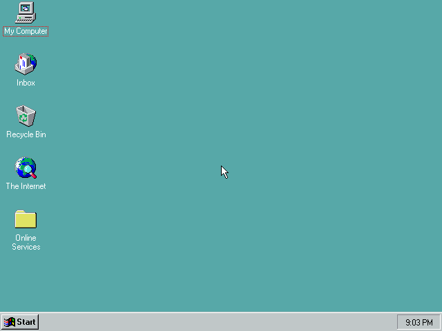 |

---

## How it works


1. **Unpack and identify.** Containers are opened (discs, packages, cabinets, ROM sets). Each file's
   CPU, OS, SDK and compiler are named, and runtime-library functions are *identified by signature*
   instead of being reconstructed — they were linked, not written.
2. **Decompile.** Machine code is lifted through SLEIGH processor specs to p-code, then into **L2**, a
   typed intermediate form where types, structures, far pointers and calling conventions are worked
   out.
3. **Write the source as it was authored.** Compiled code comes back as C; hand-written assembly
   stays assembly (MASM, NASM or the DDK's macros). Names are found once and propagated across the
   whole corpus.
4. **Build.** With OpenWatcom C and MASM, or with the original's period compilers when matching
   bytes is useful as a check.
5. **Judge.** The original and the rebuild run side by side in an emulator, from the same state with
   the same inputs, and every observable effect is compared.


The judge is tested too: `codebreaker teeth` breaks functions it passed, on purpose, and checks
that it notices.

---

## System map

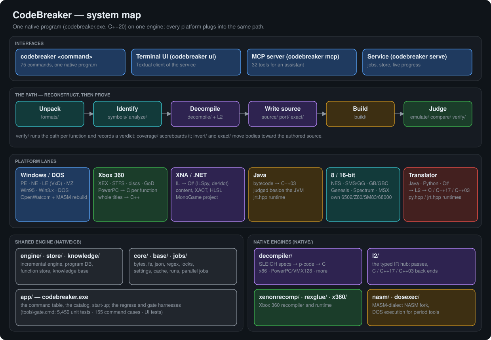

| Layer | Where | What lives there |
|---|---|---|
| Interfaces | `src/app`, `src/ui` | the command table, the Windows app (`window_*`) and its conversion pipeline (`convert`), the MCP server (32 tools), the service |
| The path | `formats` → `symbols`, `analyze` → `decompile` → `source`, `port`, `exact` → `build` → `emulate`, `compare`, `verify` | reconstruct, rebuild, judge, record |
| Lanes | `recompile`, `xna`, `java`, `translate`, `platforms`, `invert` | Xbox 360 recompilation, XNA ports, Java, the translator, platform descriptions, compiler inversion |
| Engine | `engine`, `store`, `knowledge`, `coverage`, `jobs`, `core`, `base` | incremental engine and program database, function store, knowledge base, scoreboards, jobs, the C++ foundation |

`src` alone is about 505,000 lines of C++ across 26 areas, with 5,450 unit tests.

---

## Architecture in depth

**Inside the decompiler.** Four loaders feed one engine; every format reaches the same p-code, the
same L2 passes, and the same C and assembly writers.

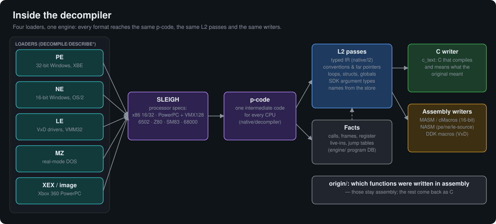

**One program, one service.** The command line, the window and the MCP server all reach
the same command table; long work runs as jobs on one service process over one state folder.

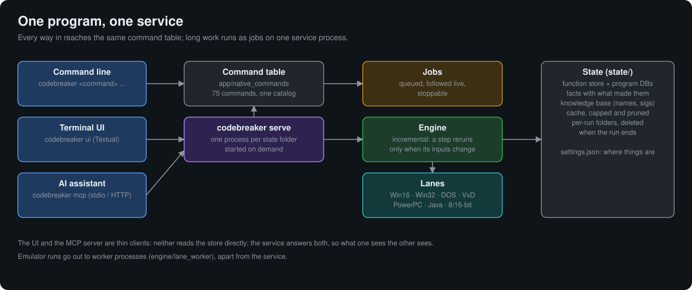

**Xbox 360: a whole title recompiled to C++.** From a retail package, disc or folder to a PC program
that builds and runs.


**The universal translator.** Every source language goes into L2 and every target comes out of it,
so a new language is one front end or one back end — never a hand-written pair.


---

## The Windows 95 proof


Per-function judging shows that each function behaves the same. The Windows 95 lane goes further:
whole modules rebuilt from CodeBreaker's source are put back into the real operating system and
used for real. The milestone regression (`codebreaker regress`) boots the 15 MINI.CAB modules to
Setup, runs the whole Setup chain on Setup's own reconstructed programs, and installs Windows 95 to
the desktop with all 22 modules rebuilt — two runs of each, on VMs.

---

## Getting started

**Download.** The [latest release](https://github.com/mrtitanic777/CodeBreaker/releases/latest) has
`CodeBreaker-2.1.0-win64.zip`: the program (`bin\codebreaker.exe`), the engines it calls and the
tables it reads, with no tests. Unzip it, add its `bin` folder to `PATH`, and run `codebreaker settings`.

**Or build from source:**

**Requirements:** Windows 10 or 11 (x64), CMake and Ninja, Git, and a C++20 compiler. CodeBreaker builds with
MSVC (Visual Studio 2022 or 2026), Clang (`clang-cl`) and GCC (MinGW-w64), and CI builds it with all three on every
push; the build scripts use MSVC (the assembler, x86asm, is part of the program). The Java lane needs JDK 21. The individual
lanes use their own tools (OpenWatcom, the period compilers, which run on the built-in DOS executive, an Xbox 360 SDK); `codebreaker
settings` lists every one and whether it was found.

```bash
git clone https://github.com/mrtitanic777/CodeBreaker.git
```

```bash
cd CodeBreaker
```

```bash
tools\build_native.cmd
```

```bash
tools\build_codebreaker_exe.cmd
```

The first builds the one native tree (the program, the decompiler and `pcodecheck`, the trace tool); the
second installs the program with the decompiler beside it. The engines (L2, the format, XEX and DOS libraries) are linked
into `codebreaker.exe`. The program is installed as `build\codebreaker.exe` (add that folder to `PATH`). Copy
`settings.example.json` to `settings.json` and point it at your corpus and tools, then:

```bash
codebreaker settings
```

```bash
codebreaker reach C:\path\to\some.dll
```

```bash
codebreaker
```

---

## Commands

Nine verbs, one program. Each works out what to do from what you give it (a file's kind, a folder's contents, a word), and `codebreaker VERB --help` says what it picks and ends with the older names it replaces. `codebreaker help` lists them:

| Command | What it does |
|---|---|
| `convert FILE` | any program to source code, picking the steps itself; `--to LANG` translates the source (proved by running both), `--asm` gives assembly source, `--check` builds and judges the result |
| `inspect FILE` | what a file is and what is inside it; `--names`, `--functions`, `--analyze`, `--classes`, `--imports`, `--facts` ask one thing |
| `extract FILE [OUT]` | the files out of a cabinet, floppy or CD image, Xbox 360 package or disc, game archive, menu or font; `--list` only lists |
| `build FOLDER` | a program made again from its source folder (a driver's or DOS program's assembly, a 16-bit DLL's C); a module name builds the whole module |
| `check FILE` | prove rebuilt source behaves like the original; `--bytes` asks for the original's bytes; a `.java`, `.cs` or `.py` file is run against its C++ translation |
| `compare A B` | two builds of a program, function by function: identical, changed, added, removed |
| `corpus [run\|progress\|scoreboard\|place\|coverage\|reach\|list]` | the whole collection: run it, watch it, score it |
| `lookup NAME` | a decorated C++ name, a DOS or BIOS interrupt, a driver service, or a name from the knowledge base |
| `xbox [xex\|edit\|crypto\|config\|match]` | the Xbox 360 specialist tools |

`settings`, `cache` (which also tidies state), `regress`, `serve`, `mcp` and `app` (the window; what `codebreaker` with no command starts) stay as they were. Every command name of earlier versions still works, hidden from `help`: `decompile x.dll` is `convert x.dll --decompile`, `pe-source` is `convert FILE --asm`, `names` is `inspect FILE --names`, `sweep` is `corpus run`, and the same output.

---|---|
| `reach <file or folder>` | what CodeBreaker makes of anything: formats, lanes, what can be reconstructed |
| `module <name>` | reconstruct one module: decompile, build, judge, write its source |
| `decompile <name>` | decompile any module (32-bit, 16-bit, PowerPC) to C |
| `measure <name>` | reconstruct and judge one module without writing to the source tree |
| `sweep` | reconstruct and judge every module of the corpus (resumable) |
| `coverage` | how much of every module is accounted for, and in what state |
| `names` / `identify` | best names for every function; runtime-library functions and what built the module |
| `recompile-project <title> --check` | an Xbox 360 title as a C++ project that runs on a PC, built and run headless |
| `xna <package>` | an XNA game as C#, content and HLSL, ready for MonoGame |
| `java <tool>` | the Java transpiler (Java to C++03) |
| `driver-source`, `dos-source`, `pe-source`, `ne-source` | whole-file assembly source, built and compared byte for byte |
| `regress all15\|setup\|install\|slow` | the milestone regression: Windows 95 boot, Setup chain, full install, slow cases |
| `convert FILE` | one file in, a folder of source code out, with its stages and percentages (the window runs the same pipeline) |
| `app` | the window (what `codebreaker` with no command starts); `app --screenshot OUT.png` draws it to a file |
| `mcp` | CodeBreaker as an MCP server, so an AI assistant can drive it ([docs/MCP.md](docs/MCP.md)) |

---

## Repository layout

```
src/                    the program: 26 areas of C++20 and its third-party code (see the system map)
src/decompile/engine/   SLEIGH processor specs and the decompiler core
src/translate/l2/       L2, the typed intermediate form, and its back ends
src/recompile/          the Xbox 360 recompiler and runtime (x360, xenonrecomp, rexglue)
data/               tables CodeBreaker reads: API maps, symbol tables, runtimes for translated code
targets/            programs being taken back to source, with their research notes
tests/              everything for testing: the command cases and goldens, fixtures
tools/              build, gate and packaging scripts (package_release.cmd makes the release zip)
docs/               design notes, platform map, tested software, diagrams
```

Unit tests sit beside the code they test (`*_test.cpp` and `testdata/` folders under `src/`). None of
the test material ships: the release package holds only the program and what it reads at run time, and
the source archives leave the tests out. Original binaries, toolchains and generated output are kept
outside version control ([docs/NOT_IN_REPO.md](docs/NOT_IN_REPO.md)).

---

## Testing

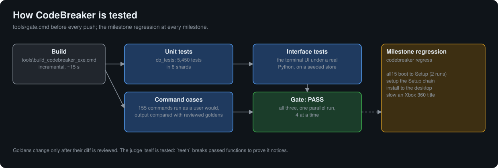

```bash
tools\gate.cmd
```

The gate builds everything and runs, in one parallel pass:

- **5,450 unit tests** (`cb_tests`, in 8 shards);
- **161 command cases** — every command run as a user would, its output compared with a reviewed
  golden ([tests/exe_gate](tests/exe_gate));
- **the window**: `codebreaker app --screenshot` in every state and both themes, each a non-empty PNG of the size asked.

The milestone regression adds the end-to-end proofs: `codebreaker regress all15`, `setup`,
`install` and `slow` (an Xbox 360 title recompiled and run headless).

---

## Documentation

| Document | About |
|---|---|
| [CONTRIBUTING.md](CONTRIBUTING.md) | how to build, test and send a change |
| [ROADMAP.md](docs/ROADMAP.md) | the nine tracks: Windows 95 in full, every console, Linux, speed, the translator, ... |
| [PLATFORMS.md](docs/PLATFORMS.md) | every platform family: what is handled, what is next |
| [TESTED_SOFTWARE.md](docs/TESTED_SOFTWARE.md) | real programs put through each lane, and the results |
| [ARCHITECTURE.md](docs/ARCHITECTURE.md) | the program database, incremental engine and service |
| [CPP_DESIGN.md](docs/CPP_DESIGN.md) | how the C++ is written: vocabulary types, errors, layering |
| [TRANSLATOR_DESIGN.md](docs/TRANSLATOR_DESIGN.md) | the universal translator over L2 |
| [RECOMPILE.md](docs/RECOMPILE.md) | Xbox 360 titles recompiled to C++ |
| [VXD.md](docs/VXD.md), [WIN16_LESSONS.md](docs/WIN16_LESSONS.md) | the Windows 9x driver and 16-bit lanes |
| [MCP.md](docs/MCP.md) | driving CodeBreaker from an AI assistant |
| [PYTHON_RETIREMENT.md](docs/history/PYTHON_RETIREMENT.md) | how the program moved from Python to native C++ |

---

## License

Apache License 2.0 — see [LICENSE](LICENSE) and [NOTICE](NOTICE). Third-party components under
`native/` keep their own licenses.
