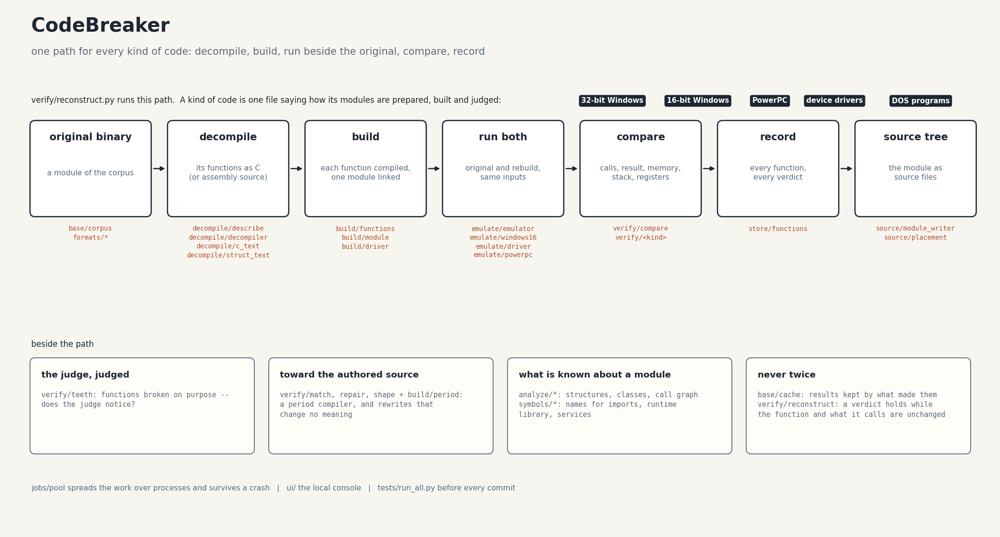

# CodeBreaker

Reconstructs readable, maintainable, compilable source from binaries, and checks that what it
wrote behaves like the original.

A reconstruction is only counted when it has been compiled, run next to the original in an
emulator on the same inputs, and observed to do the same things: the same calls with the same
arguments, the same return value, the same memory left behind, the same stack and registers.
Byte-identical output is not the goal; it is used as a signal for which of several sources that
all behave right is nearest to what a person wrote.



## What it handles

| Kind of code | Decompiled to C | Rebuilt | Judged |
|---|---|---|---|
| 32-bit Windows modules | yes | per function, into a DLL | by behaviour, beside the original |
| 16-bit Windows modules | yes | per function, into a DLL | by behaviour, beside the original |
| PowerPC images | yes | per function, into one image | by behaviour, beside the original |
| Virtual device drivers | to assembly source | whole, from that source | byte for byte, and by behaviour |
| Real-mode DOS programs | to assembly source | whole, from that source | byte for byte |
| Java programs (source) | transpiled to C++03 | per class, with the host compiler | by behaviour beside the JVM (static methods), else compiles |

All six go through one path (`verify/reconstruct.py`); a kind is one small file that says how
its modules are prepared, built and judged.

## One of each

```
codebreaker/
  base/        settings.py   where things are on this machine (settings.json)
               corpus.py     the original binaries: find one, identify it
               cache.py      results kept by what made them: nothing is compiled or decompiled twice
               parallel.py   the one number of things that run side by side
  formats/     reading files: pe, ne, le (drivers), dos, powerpc_image, resources, cab, media, fonts
  decompile/   describe.py   take a file apart and describe it to the decompiler
               decompiler.py THE decompiler: run the native program on a description
               c_text.py     make its output C that compiles and means what the original meant
               struct_text.py  field accesses written as fields (p->f_48)
  build/       functions.py  THE builder: compile each function, link a DLL / an image
               module.py     a whole module: functions, data, resources, exports
               driver.py, resources.py, definitions.py, disc_image.py
               period.py, msc6.py, msvc152.py   compilers of the original's time
               period16.py   a 16-bit DLL built with Microsoft C 6 and LINK 5.60
               flat_thunk.py a 32-to-16-bit thunk DLL built with the thunk compiler, ML, CL and LINK
               masm.py, dos_tools.py, dos_sessions.py   DOS tools run in DOSBox-X
  emulate/     one runner per kind, one door: emulate.runner(kind)
               emulator.py (32-bit), windows16.py, driver.py, powerpc.py
  analyze/     call graph, conventions, globals, strings, structures, classes, dispatch
  symbols/     names: imports by number, runtime-library functions, C++ names, DOS and driver
               services, debug symbols and the source file each function came from, debug builds
  verify/      reconstruct.py  THE path: decompile, build, run, compare, record
               compare.py      THE comparer: do two builds of a function behave alike?
               win32.py, win16.py, powerpc.py, driver.py, dos.py    what differs per kind
               teeth.py        the judge judged: functions broken on purpose
               match.py, repair.py, shape.py   toward the authored source, with a period compiler
               sweep.py, measure.py            the corpus, and one module
  store/       functions.py  THE store: every function, every reconstruction, every verdict
  jobs/        pool.py       THE runner: work spread over processes, surviving a crash
  source/      module_writer.py, placement.py   the reconstructed module as source files, in the tree
               readable.py   SDK constants and names written in after judging (same object code)
               driver_writer.py, dos_writer.py, assembly.py   assembly source that builds back
               vxd/          a driver as the driver kit's macro source (Declare_Virtual_Device ...)
               ne_asm/       16-bit hand-written assembly as SDK cMacros source (cProc, cBegin ...)
  invert/      compiler models: the code a compiler emits for each statement, read backwards --
               Microsoft C 2.03 / the C of 1983-84, Microsoft C 6, Visual C++ 1.52 and 2.0
  compare/     versions.py   the functions of two builds of a module: same, changed, added, removed
  coverage/    ledger.py     how much of every module is accounted for
  java/        the Java transpiler (was J2CTool): Java source -> C++03, deterministic
               transpile.py  THE converter: parse, resolve types and ownership, emit, check
               emit/, rules.py, runtime.py, profiles/ (Minecraft eras), platform/ (the console layer)
               console/      the Xbox 360 port: assets, XACT audio, achievements, the post-convert
                             rewrites, the Visual Studio project; run.py: `java <tool>`
  ui/          the local web console and the desktop window
native/decompiler/   the native decompiler (C++): decompiler.cc around the Ghidra decompiler core
                     in core/ (Apache-2.0, see core/LICENSE, core/NOTICE)
tests/               python tests/run_all.py -- run before every commit
tools/               measuring and keeping the code base itself in order
docs/                STATUS.md (where things stand), NOT_IN_REPO.md (what to attach, and its setting)
```

## Setup

Copy `settings.example.json` to `settings.json` and fill in where the original binaries and the
OpenWatcom compiler are; `pip install -r requirements.txt`. The rest is optional -- the period
compilers, DOSBox-X, MASM, the PowerPC compiler -- and docs/NOT_IN_REPO.md lists each with its
setting. `workers` is how many things run at once (default half the processors, at most 6).
Results and caches go to `state/`. Neither is committed.

## Use

```
python -m codebreaker module comctl32.dll      decompile, build, judge, write the module's source
python -m codebreaker measure commdlg.dll      the same without writing to the source tree
python -m codebreaker sweep [--16 | --all]     every module of the corpus, resumably
python -m codebreaker scoreboard               rewrite the scoreboard from stored results
python -m codebreaker teeth advapi32.dll       break verified functions on purpose: does the judge notice?
python -m codebreaker repair comctl32.dll      move each function toward the bytes a 1994 compiler gave
python -m codebreaker decompile user.exe       just the C, for any module
python -m codebreaker driver-source vkd.vxd    a driver's assembly source, built back and checked
python -m codebreaker dos-source find.exe      the same for a real-mode program
python -m codebreaker analyze shell32.dll      structures, classes, call graph, conventions
python -m codebreaker invert olecli.dll        functions read back into the source their compiler was given
python -m codebreaker vxd idiom vkd.vxd        a driver as the driver kit's macro source
python -m codebreaker ne-asm idiom KRNL386.EXE 1 0x4a4 0x4fa   16-bit assembly as cMacros source
python -m codebreaker build16 tests/fixtures/lzexpand          a 16-bit DLL with the period tools
python -m codebreaker flat-thunk lz32.dll --build DIR          a thunk DLL with the period tools
python -m codebreaker module path/to/java/src  a Java program as C++03, every class compiled and labelled
python -m codebreaker java convert SRC OUT --platform xbox360 --project   the transpiler's own tools
python -m codebreaker                          every command
```

A run of a module that was run before only redoes what changed: a verdict holds for as long as
the function's source, and the source of everything it calls, is the same.

## What a verdict means

```
VERIFIED            ran beside the original on every input and did the same, returning cleanly
VERIFIED (weak)     the same, with a stated limit: low coverage, only faults compared, a callee
                    that was a stand-in, an import whose arguments could not be compared
UNVERIFIED          did something different; the store says what and on which input
NOT JUDGED          neither side could be run on any input
DOES NOT COMPILE    the reconstruction is not yet C the compiler accepts
NO SOURCE           the decompiler produced nothing
```

A Java class is run beside the original where it can be: its static methods with primitive
parameters and results are called on the same inputs in the JVM (the source compiled by javac) and
natively, and compared exactly -- VERIFIED, or VERIFIED (weak) "methods-partial" when only some of
its methods could be run. A class with no such method is NOT JUDGED once it compiles.

`teeth` is what says how far to trust the first of these: it breaks functions the judge passed
(a constant one higher, a comparison turned round, a store left out) and counts how many of the
breaks the judge catches.

## Toward the authored source

Many sources behave alike; only one was written. `repair` compiles each verified function with
a compiler of the original's time and searches rewrites that change no meaning for the one whose
bytes are nearest the original's: the compiler switches the module was built with, a frame
pointer kept or not, the declarations in force, a `switch` for an if-chain, an early return.
The period compiler is given the declarations an author had (imports as imports, globals as
variables). The search itself is tested on source known to be the authored one: Microsoft's
1984 librarian, whose reconstruction compiles to the original byte for byte -- each function is
knocked away from it and must be brought back.

## Keeping it one of each

The test gate fails if a module does not import, imports something that is not there, or if
anything in the package is unused. The tools that keep it so:

```
tools/tidy.py --apply      remove unused imports, unused definitions, unreachable modules
tools/carve.py --apply     remove what a real run never calls and nothing live refers to
tools/merge.py A B         fold module A into module B and point every user at B
tools/move.py A B names    move definitions from A to B
tools/sample.py 16 14      a quick reading across several modules
tools/causes.py 16|32      why functions are not verified, across all judged modules
tools/failures.py MODULE   the same for one module
tools/trace16.py M F       one 16-bit function, original and rebuilt, side by side
tools/chart.py             redraw docs/architecture.png
```

## Where this came from

A restructuring of an earlier checkout that had grown by accretion (its last state is the tag
`v1-before-consolidation`). What it had that is still of use was brought into this package and
checked against what the old code produced; the rest was retired. The tool is this package.
