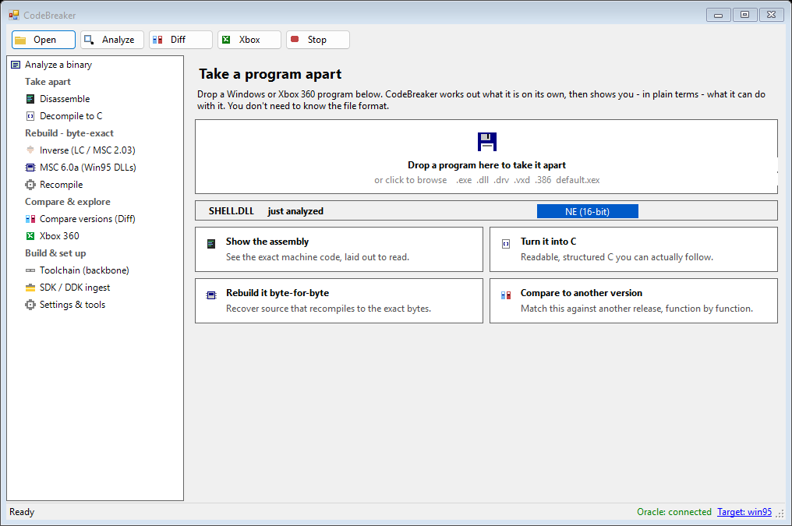

# CodeBreaker

**Take a program apart, see how it works, and rebuild it — byte for byte.**

CodeBreaker is a reverse-engineering workbench. You give it a program — a Windows `.exe` or
`.dll`, or an Xbox 360 title — and it disassembles it, turns it into readable C, and for
supported cases can recover source code that recompiles to the *exact same bytes* as the
original. Everything it claims, it proves by rebuilding and comparing; it never guesses.

It ships as a **tool only**. It contains no Microsoft code, no game code, nothing copyrighted —
you point it at files you have the right to analyze. See **[Disclaimer](#disclaimer)**.



## Start here

The easiest way in is the **workbench** — an ordinary desktop app. Drop a program onto it and it
tells you, in plain terms, what the file is and what you can do with it.

- **Have the packaged app?** Double-click **`CodeBreaker.exe`** and the workbench opens.
- **Running from source?**
  ```bash
  pip install -r requirements.txt
  python wt.py            # opens the workbench
  ```
- **Prefer the command line?** It's the same program — run it *with a command* instead of
  double-clicking: `python wt.py doctor`, `python wt.py diff versions`, and so on. In the
  packaged app, `CodeBreaker.exe doctor` behaves the same way.

That's all you need to look around, disassemble, and decompile. The one thing that needs extra
setup is the **byte-exact rebuild** loop, which drives real period compilers — see
**[Get the dependencies](#get-the-dependencies)**.

## What you can do with it

- **Take a program apart** — disassemble any Windows (16/32-bit) or Xbox 360 binary into clean,
  reassembleable assembly.
- **Turn it into C** — lift that assembly into readable, structured C you can actually follow.
- **Rebuild it byte-for-byte** — for supported classes, recover source that recompiles to the
  *exact* original bytes (proven by rebuilding, not by eye). On the Win95 VxD target, the
  byte-exact loop verifies all **222/222** modules (903/903 objects) — and a Python LE/W3 writer
  re-synthesizes them into loadable binaries: the reconstructed **VMM kernel + static VxD stack
  boot real Windows 95 to the logon** (see [`tools/vmm32boot`](tools/vmm32boot)).
- **Reconstruct whole modules to clean C / C++** — the Win95 *Layer-2* pipeline classifies every
  function of a 32-bit PE, emits clean C (`emit_c`) and clean C++ for `__thiscall` methods
  (`emit_cpp`) — each **confirmed byte-exact by the period MSVC compiler** — and takes everything
  else to a byte-exact ASM floor, so a module is always 100% covered and nothing is faked. See
  [`codebreaker/targets/win95/L2_PIPELINE.md`](codebreaker/targets/win95/L2_PIPELINE.md).
- **Compare across versions** — line the same function up across releases (even 16-bit → 32-bit)
  and carry a recovered name forward onto its twin.
- **Reconstruct it by experiment** — the *behavioral engine* runs the real machine code as an
  oracle (Unicorn), records structured evidence of what it does, actively experiments to learn
  what each input means, builds hypotheses with confidence, and — for the functions the evidence
  pins down — synthesizes C that it then differential-tests back against the binary. Empirical,
  not guesswork:
  `wt behavior trace | experiment | explore | hyp | graph | synth | struct | cfg | globals | loops | recon | sweep`
  A cascade of specialist engines, each validated on the oracle, routes every function to whatever
  explains it:
  - **synth / multisynth / piecewise** — pure input→output expressions (single- and multi-statement).
  - **struct / effect** — struct layouts and field-level side effects from a pointer argument.
  - **globals / gptr** — writes to global state (byte/word/dword-typed; consecutive writes collapse
    into array loops) and global-pointer structs.
  - **loops** — counted-loop idioms: memset/fill, `strlen` (scan-to-sentinel), `memcpy` (copy).
  - **cfg / cfgstruct** — control flow: branch predicates, and the *structured skeleton* (basic
    blocks + conditions from `cmp`/`jcc`) with each call placed in its block.
  - **interproc** — "orchestrator" functions reconstructed as their call sequence, with call
    arguments mapped to the caller's parameters, **exact arg counts from the SDK protos**, and
    **value flow** (`r0 = f(x); g(r0); return r0`).
  - **envprov** — provisions plausible OS state so functions that fault on a null-global deref/call
    run to completion, then reconstructs them.

  And the readability/rigor layer applied across the emitters:
  - **datarec** — resolve constant pointers to their data: strings become `"Cannot open %s"`.
  - **type propagation** — infer real types (`HWND`, `LPCSTR`, `HANDLE`) from how values flow into
    SDK calls, instead of `unsigned`.
  - **switch / jump-table** — `jmp [table + idx*4]` → `switch (idx) { case … }`.
  - **vtable / COM** — virtual dispatch `call [this + N]` → a named `vcall_N`.
  - **SEH** — recover `__try { … } __except (handler) { }` frames.
  - **dataflow (SSA-lite)** — name predicate operands by source, so a condition reads
    `if (result != 0)` / `if (a0 == 0)`, not `if (eax == ecx)`.
  - **structverify** — upgrade a structural reconstruction to *verified* when the function is
    single-path (its observed behavior is then complete).
  - **constants** — magic constants → SDK flag/enum names (`LMEM_ZEROINIT`, `MB_YESNO | MB_ICONQUESTION`).
  - **register args / thiscall** — capture ecx/edx so C++/COM methods show `/*this=*/` and fastcall args.
  - **fpsynth** — x87 floating-point reconstruction (traces float/double args, fits an FP grammar).
  - **typeunify** — propagate types across the call graph (a param forwarded to a typed callee is typed).
  - **stackframe** — recover the frame and declare typed locals (`unsigned local_8; ...`).

  And the structure / naming / vector layer that makes the output read like the authored source:
  - **structure** — lift the goto/label CFG into real `if` / `if-else` / `while` for every reducible
    region it can *prove*, keeping `goto` only where the control flow is genuinely irreducible (a
    mis-lifted loop is wrong C, so the bar is a proof). cfgstruct emits through it.
  - **fpblock** — recover x87 float math *embedded* inside a bigger function, per block:
    `dst = (a * b) + c;` (fpsynth only reached whole leaf float functions).
  - **simdblock** — MMX/SSE packed ops → intrinsic form (`xmm0 = _mm_mul_ps(a0, a4);`). ~zero on
    Win95 by era (predates MMX/SSE); there for later multimedia/driver corpora.
  - **callconv** — detect stdcall / cdecl / thiscall / fastcall (and the `ret N` arg count) and stamp
    `__stdcall` etc. onto the recovered signature.
  - **callgraph** — the module's static call graph: fan-in/out, recursion cycles (SCCs), and the
    reverse-topological order for bottom-up reconstruction.
  - **interproc_v3** — bottom-up whole-module pass: name callees before callers, so a caller's
    internal `sub_x(...)` calls are labeled with the callee's recovered purpose.
  - **funcname** — a hypothesized name from the API fingerprint (`/* likely: WindowProc */`).
  - **fieldname** — turn `p->f_4` into `p->hwnd` by matching accessed offsets to SDK struct layouts.

  And the origin-triage, typing, and readability layer (latest):
  - **crtsig** — identify CRT / compiler-helper functions (`_chkstk`, `__allmul`, `__ftol`, the
    intrinsic `memcpy`/`memset`, `_EH_prolog`) so recon marks them *toolchain* and does **not**
    reconstruct the compiler's own output (triage by origin first).
  - **libsig** — FLIRT-style identification of statically-linked library functions (C runtime, MFC,
    OLE), with signatures built from the period `.OBJ`/`.LIB` files themselves (FIXUPP reloc masks).
  - **fmtargs** — type a printf-family call's varargs from its format string (`%s`→`LPCSTR`, `%ld`→`long`).
  - **ssa** — cross-block value resolution, so a predicate reads `if (a0 == a1)`, not `if (esi == edi)`.
  - **localname** — name locals from use (`local_8`→`i`, `local_c`→`p`); **rettype** — infer the
    return type (`void` / value / pointer); **callconv** — stamp `__stdcall`/`__thiscall`/`__fastcall`.
  - **string idioms** — `strcpy`/`strcat`/`strcmp`/`wcslen`/`memcmp` loop recognition; **structure**
    also lifts `do-while`/`for`, short-circuit `&&`/`||`, and real `switch` case values + `default`.

  And the C++ / advanced layer (latest):
  - **demangle** — MSVC-mangled names → readable C++ signatures
    (`?AddRef@CFoo@@UAGKXZ` → `public: virtual unsigned long __stdcall CFoo::AddRef(void)`); names a
    huge number of MFC/OLE functions for free.
  - **rtti** — MSVC RTTI → real **class names and inheritance** (`class CFoo : public CObject`); pairs
    with `classlayout` and `demangle` to crack C++/COM binaries open.
  - **structsynth** — synthesize a **novel struct** from a pointer's field-access pattern when it isn't
    a known SDK type, so app-specific `p->f_4` becomes a declared, typed member.
  - **globalname** — name and type module globals from use (`g_hInstance`, `g_count`, `g_pHead`).
  - **tailcall** — identify import thunks (`jmp [IAT]`, named not reconstructed) and tail calls
    (`jmp f` → `return f(...)`).
  - **strdispatch** — a chain of `strcmp` against literals → the keyword→handler verb table.

  And the MFC / cross-function layer (latest):
  - **mfcmap** — MFC `AFX_MSGMAP` arrays → the authored **`BEGIN_MESSAGE_MAP`** block (ON_WM_* /
    ON_COMMAND / ON_MESSAGE handler wiring); recovers an MFC app's entire event routing as source.
  - **demangle (templates)** — `?$CArray@H@@` → `CArray<int>` (MFC/STL template classes).
  - **arity** — pin a function's parameter count by **consensus across all its call sites** (+ `ret N`).
  - **structsynth (bit-fields)** — a mask/shift field → real C bit-fields (`unsigned flag : 1;`).
  - **compiler_id** — fingerprint the toolchain (linker version + Rich header + CRT strings) to guide
    which library signatures `libsig` applies.
  - **enumrec** — constants a variable is compared against → a recovered `enum`.
  - **sigrefine** — varargs (`...`) detection, BOOL-parameter detection, identical-function folding.

  And the MFC / C++ / navigation layer (latest):
  - **mfcord** — MFC's **ordinal-only imports** (`MFC250.dll!#282`) → real C++ names, from the
    period `.def`/`.lib` ground truth (`@282` → `CDocTemplate::CDocTemplate`); names thousands at once.
  - **mfcmap** — MFC **message / interface / dispatch maps** → `BEGIN_MESSAGE_MAP` /
    `BEGIN_INTERFACE_MAP` / `BEGIN_DISPATCH_MAP` (the app's event + OLE wiring).
  - **mfcclass** — MFC **CRuntimeClass** structures → class names + inheritance **without RTTI**.
  - **cxxeh** — MSVC `__CxxFrameHandler` tables → real `try { } catch (T) { }` with the caught types.
  - **stackstring** — strings built inline on the stack (`mov [ebp-8],'H'`) → the literal `"Hello"`.
  - **xref** — a whole-program cross-reference index (reverse call graph, string/import indices).
  - **constprop** — forward constant propagation through registers (pins args, resolves const pointers).

  And the 16-bit / driver frontier (the other half of the corpus — 360 NE, 223 VxD, 88 DOS):
  - **win16ord** — Win16's **ordinal-only imports** (`USER.1`) → real API names (`MESSAGEBOX`), from
    the shipped export `.def` tables (the whole 16-bit surface: USER/GDI/KRNL386/COMMDLG/SHELL/…);
    resolves an NE module's IMPORTORDINAL fixups. Names most of a 16-bit binary's calls at once.
  - **vxdsvc** — VxD **ring-0 service calls** (`int 20h` + service id) → named VMM/VxD services
    (`VMM_Get_VMM_Version`), from the DDK service tables. (VMM.VXD: 3,111 named calls.)
  - **dosint** — **DOS/BIOS interrupts** (`int 21h`/`10h`/`13h`/`16h`/…) → named system calls
    (`DOS_WriteFile`, `BIOS_Video_TeletypeOutput`).
  - **neidiom** — Win16 NE idioms: far/exported prologs, `__loadds`, MakeProcInstance thunks, and
    intra-module far-call (INTERNALREF) fixups.
  - **peextra** — delay-load imports, TLS callbacks, and RT_RCDATA classification.
  - **neresources** — **16-bit NE resources → `.rc`**: string tables, menus, dialogs, accelerators,
    and BITMAP/ICON/CURSOR — the entire UI surface of a Win16 app (its own format, not PE `.rsrc`).
  - **vxdddb** — a VxD's **Device Descriptor Block** (name, device ID, version, entry points) and its
    **control-message handlers** (Device_Init, PnP_New_Devnode, …) — what a VxD *is*.
  - **thunk32** — 32↔16 thunk-layer identification; **vbxmodel** — VBX control property/event names;
    **installer** — installer/packaging family + embedded INF script (all niche).
  - **16-bit code cascade** (`tracer16` / `recon16` / `interproc16`) — reconstructs 16-bit NE
    function bodies: a leaf synth for pure functions, and **caller reconstruction** that recovers a
    Win16 function's named call sequence (`CreateWindow → AppendMenu → WinHelp …`) statically from
    the relocation table. Covers **every** function — exports *and* internal (found via far/near
    call targets), the bulk of 16-bit code. (UNITOOL.EXE: 82 of 123 functions reconstructed.)
    Functions get their **real authored names** from the NE name tables (`MAINWINDOWPROC`), calls
    get their **arguments** (from a sentinel-arg trace) **typed** by the Win16 proto DB
    (`win16proto`, 679 signatures from the SDK `WINDOWS.H`), and string arguments resolve against
    the module's data segment (`datarec16`) — `MessageBox(hWnd, "Cannot open %s", "Error", MB_OK)`.
    Callbacks get their real **signature** (`callbacksig16`: `LRESULT CALLBACK MainWindowProc(HWND,
    UINT, WPARAM, LPARAM)`) and the **WM_ messages** they handle (`wmdispatch16`), and the DGROUP
    **data** (pointer tables + globals) is recovered as C (`datainit16`).
    Finally, **resxref16** cross-links the two halves — `WM_COMMAND` cases to menu items, `LoadString`
    ids to strings, `GetDlgItem` ids to dialog controls, `DialogBox` to its DlgProc.

  Reconstruction engines that recover the *non-code* half of a module, as source:
  - **resources** (`recon/resources.py`) — the PE `.rsrc` tree back to `.rc`: STRINGTABLE,
    **VS_VERSION_INFO, ACCELERATORS, and MESSAGETABLE decoded, and RT_BITMAP/ICON/CURSOR extracted
    to real `.bmp`/`.ico`/`.cur` files**.
  - **dialogs** (`recon/dialogs.py`) — **RT_DIALOG / RT_MENU binary templates back to authored `.rc`
    `DIALOG`/`MENU` source** (controls, rects, styles, fonts; nested POPUP/MENUITEM trees).
  - **typelib** (`recon/typelib.py`) — a COM **type library back toward IDL** (MSFT fully; the older
    SLTG partially — interfaces, coclasses, and GUIDs, e.g. IUnknown/IDispatch and their methods).
  - **classlayout** — **vtables → C++/COM class structs** (IUnknown/IDispatch prefix labelled).
  - **datainit** (`recon/datainit.py`) — initialized global data (function-pointer tables, vtables,
    string globals) as C initializers, via the base relocations.

  `recon` orchestrates the whole cascade across a module; `sweep` reports coverage and what blocks
  the rest. Together the floor engines recover **~93%** of the functions the leaf engines alone
  leave on the floor — a window procedure, for example, comes back as
  `sub(HWND a0, UINT a1, WPARAM a2, LPARAM a3) { … LRESULT r = DefWindowProcA(a0,a1,a2,a3); return r; }`.
- **Xbox 360** — the same discipline for XEX2 / PowerPC, plus package, crypto, and forensics tools.

## Get the dependencies

CodeBreaker itself is just the tool, and disassembly, decompiling, and browsing work out of the
box. The **byte-exact rebuild** loop drives the *original period toolchains*, which you attach
yourself. Open **Settings & tools** in the workbench (or run `python wt.py doctor`) to see what's
configured — a green dot means ready.

| Tool | What it's for | Where to get it |
|---|---|---|
| **DOSBox-X** | runs the DOS-era compilers | https://dosbox-x.com/ |
| **7-Zip** | unpacking archives / disc images | https://www.7-zip.org/ |
| **Ghidra** *(optional)* | extra cross-checking | https://ghidra-sre.org/ |
| **NASM** — the bundled `nasm-masm` fork | native assembler | build it (below); upstream: https://www.nasm.us/ |
| **Period Microsoft compilers** — MS C 6.0a, MASM 5.1, MS C 2.03, MSVC 1.52c | the exact tools the originals were built with | see the note below |

**Building the bundled NASM.** The MASM-matching assembler lives in `tools/nasm-masm/` as source.
Build it (`sh autogen.sh && ./configure && make`, or `nmake -f Mkfiles/msvc.mak`) and point
`config.json`'s `nasm` at the resulting `nasm` executable. It lets the byte-exact rebuild run
natively (no DOSBox), ~10–20× faster — see [`docs/NATIVE_ASSEMBLER.md`](docs/NATIVE_ASSEMBLER.md).

**The vintage Microsoft compilers.** These are decades-old Microsoft products and are **not**
distributed with CodeBreaker — use a copy you are licensed to use. For preservation they are
commonly archived at **WinWorld** (https://winworldpc.com/) and the **Internet Archive**
(https://archive.org/); obtaining and using them is your responsibility and remains subject to
Microsoft's rights. You only need these for the byte-exact rebuild loop, not for disassembly,
decompiling, or the cross-version tools.

Copy `config.json.example` to `config.json` and fill in the paths you use (the workbench's
**Settings** panel writes the same file). A full inventory of everything that lives outside the
repo is in [`docs/NOT_IN_REPO.md`](docs/NOT_IN_REPO.md).

## Under the hood

One program — `wt.py`, packaged as `CodeBreaker.exe` — drives everything. The workbench (`wt ui`)
is a friendly face over the same commands:

```
wt ui                    the workbench (also what a double-click opens)
wt diff <cmd>            compare a function across releases (+ a git-style browser)
wt inverse <cmd>         recover byte-exact C (Lattice C 2.12 / MS C 2.03)
wt behavior <cmd>        run the binary as an oracle: trace -> experiment -> hypotheses -> synthesize
wt msc6 <cmd>            byte-exact 16-bit Windows (NE) DLL reconstruction
wt recompile <cmd>       take recovered C the rest of the way (compile → link)
wt backbone <cmd>        the uniform compiler / assembler / linker / disassembler interface
wt xbox <cmd>            Xbox 360 (XEX2 / PowerPC) reconstruction + console tools
wt sdk <cmd>             read an SDK/DDK into typed signatures
wt --target <era> <cmd>  per-era tools (win1.0 / win3.1 / win95 / win98)
wt doctor                what's installed and configured
```

Requirements: **Python 3.10+** and the packages in `requirements.txt` — **Capstone** for
disassembly, **pycdlib** for ISO images, **pycryptodome** for the Xbox crypto, and **pythonnet**
for the native UI on Windows (the UI falls back to a built-in one if pythonnet isn't present).

Reconstruction means the emitted source re-assembles/re-links to the *exact* original bytes,
verified by rebuilding — nothing is claimed that isn't proven against the input, and anything the
tools cannot decode is flagged, never faked.

For the full engineering overview — every engine, its entry command, status, and the measured
byte-exact results — see **[`docs/ARCHITECTURE.md`](docs/ARCHITECTURE.md)**.

### Layout

CodeBreaker is an installable package (`pip install -e .`); `wt.py` is the single CLI entry.

```
pyproject.toml   packaging (makes `codebreaker` importable; deps; the `wt` console script)
wt.py            single dispatcher / CLI (and the double-click entry point)
config.json      local external-tool paths (git-ignored; copy config.json.example)
codebreaker/     the tool's core — one package, grouped by role
  core/            shared base: paths resolver, layout, config, toolchain, parallel, progress
  formats/         NE / PE / LE / OMF parsers
  disasm/          disassembly & carving
  ir/              IR engine: asm → typed IR → readable C
  cli/             shared CLI helpers
  engines/         the reconstruction engines
    inverse/         compiler-inverse: bytes → byte-exact C (Lattice C / MS C 2.03)  → wt inverse
    recon/           byte-exact reconstruction + conductor
    behavior/        dynamic reconstruction: trace/experiment/hypotheses/graph/synth/
                     struct/cfg/globals/recon (run the binary as an oracle)          → wt behavior
    msc6/            MSC-6.0a byte-exact 16-bit NE reconstruction                     → wt msc6
    recompile/       make the lifted C compile/link                                  → wt recompile
    diff/            cross-version fingerprint / match / propagate + git-style UI     → wt diff
    match/ symbol/ build/ coverage/   supporting engines
  toolchain/       backbone (uniform compiler/asm/linker interface → wt backbone),
                   sdk (→ wt sdk), reference, ghidra
  studio/          the workbench UI (native WinForms, GDI fallback)                   → wt ui
  xbox/            Xbox 360: XEX2/PowerPC recon + console/crypto/forensics            → wt xbox
  targets/         per-era overrides (win1.0 … win98), loaded by path as DI           → wt --target
tools/           vendored build-time tooling + smoke.py (source only; binaries not committed)
  nasm-masm/       NASM fork with MASM-matching output (the native assembler)
binaries/        git-ignored DATA HOME: corpus, toolchains, VMs, build output (attach your own)
```

## What is not in the repo

CodeBreaker tracks **tool code only.** Input corpora, the period Microsoft toolchains, VM images,
build artifacts, machine-specific config, and any secrets are never committed — they're attached
locally. The authoritative inventory, with sizes and re-attach steps, is in
[`docs/NOT_IN_REPO.md`](docs/NOT_IN_REPO.md).

## Disclaimer

CodeBreaker is intended for **interoperability, preservation, security research, and
education**, applied to software **you have the legal right to analyze**.

- This repository contains **no** operating-system code, binaries, headers, SDKs, DDKs,
  compilers, or other third-party/proprietary material. The tool operates only on inputs
  **you** provide.
- **Reconstructed output is a derivative of its input.** Whatever you produce by pointing
  CodeBreaker at a binary carries the copyright status of that binary. Producing, storing,
  or distributing such output is **your responsibility** and may be restricted by copyright
  law and by the software's license — obtain the rights you need first.
- The authors distribute the *tool* only, and make no representation that any particular
  use is lawful in your jurisdiction. Provided "AS IS", without warranty (see LICENSE).

Do not use CodeBreaker to infringe copyright, breach a license or contract, or circumvent
technical protection measures where doing so is unlawful.

## License

[Apache License 2.0](LICENSE). Copyright 2026 The CodeBreaker Authors. See [NOTICE](NOTICE).
