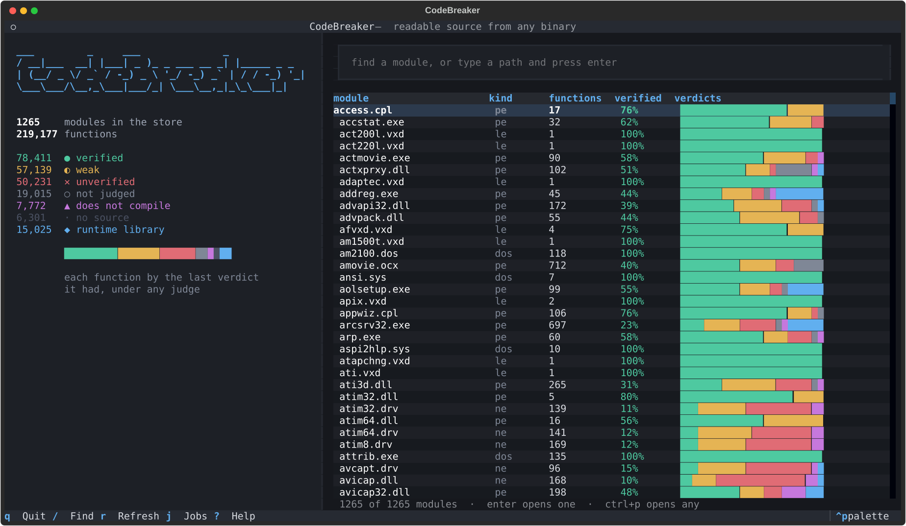
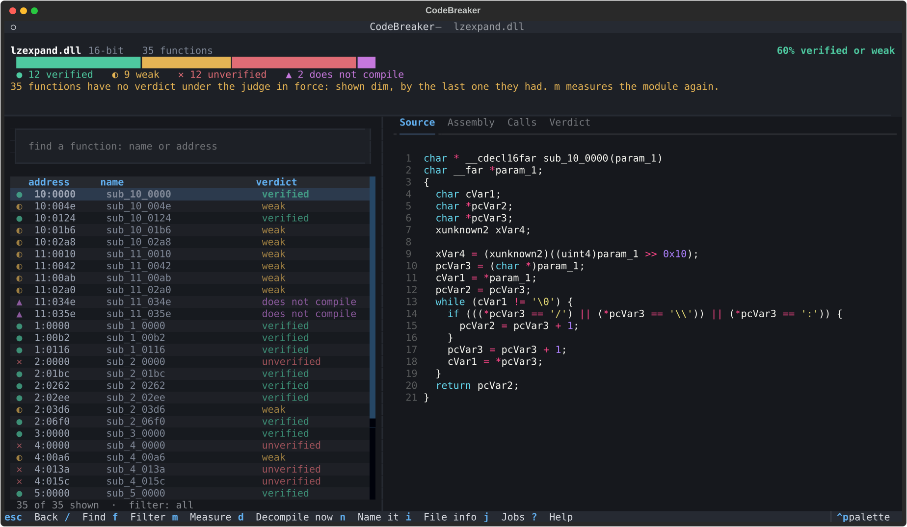
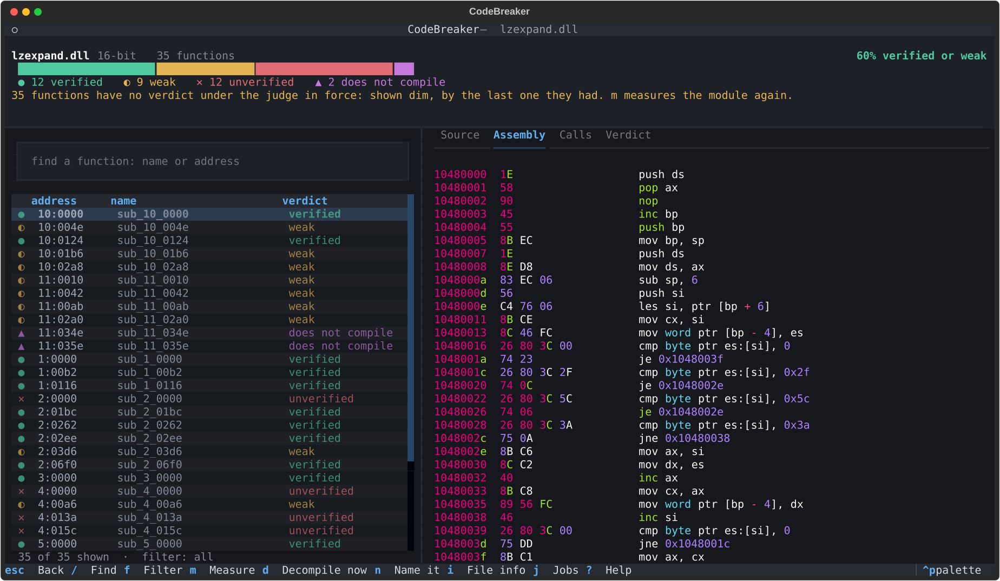
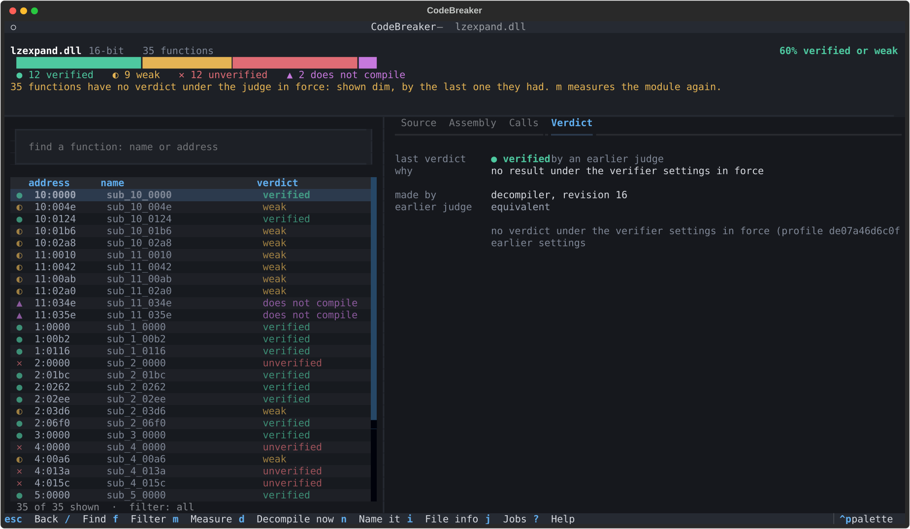
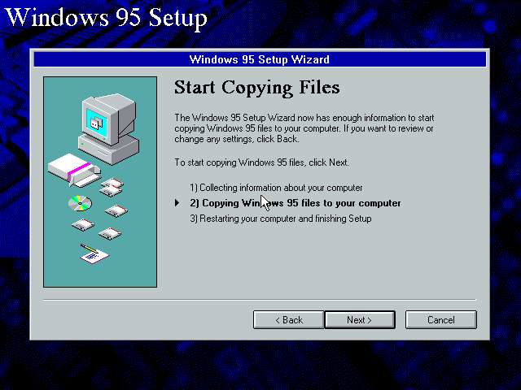
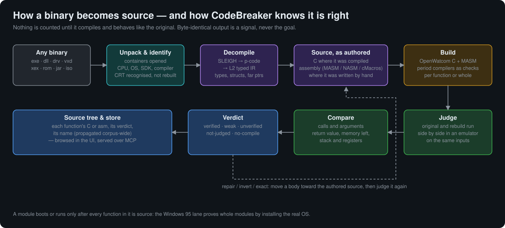
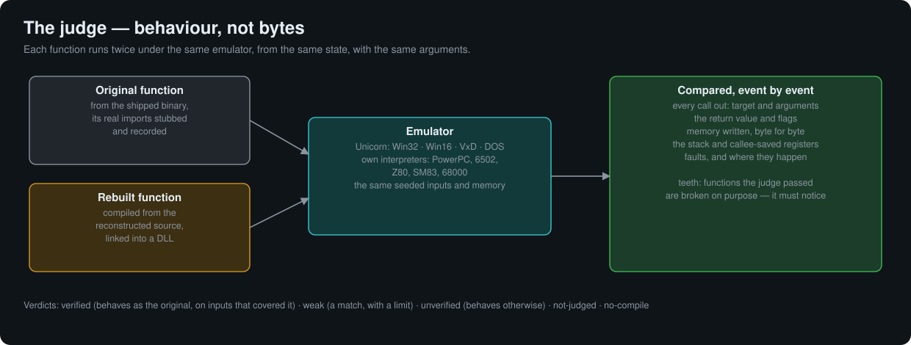
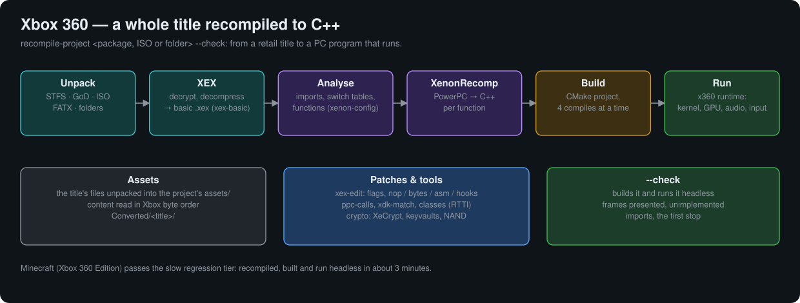
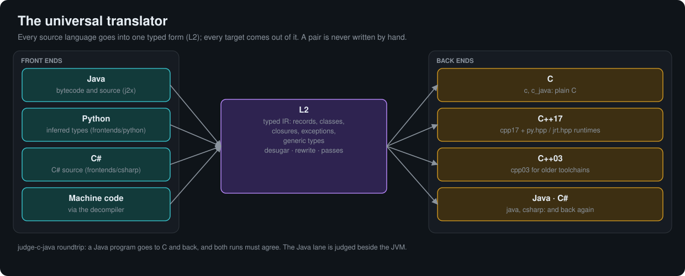
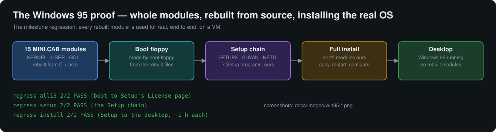

# CodeBreaker

**Binaries back to readable source — proven by running it.**

CodeBreaker takes a compiled program — a Windows DLL, a DOS tool, a device driver, an Xbox 360 game,
a Java program, an 8-bit cartridge — and gives back source code a person can read, change and build,
in the language it was first written in. Then it proves the source is right: it compiles it, runs
it beside the original in an emulator on the same inputs, and compares what both actually did.

A function only counts when it **compiles** and **behaves like the original**: the same calls with
the same arguments, the same return value, the same memory left behind, the same stack and
registers. Byte-identical output is never the goal; it is only used as a hint for which of several
correct sources is closest to what was originally written.



> **Version 1.0.0** — the first official release. CodeBreaker is one native C++20 program (`codebreaker.exe`). Every command
> runs natively; the only Python left is the terminal interface, a thin client of the native service.

---

## Contents

- [What it handles](#what-it-handles)
- [See it work](#see-it-work)
- [How it works](#how-it-works)
- [System map](#system-map)
- [Architecture in depth](#architecture-in-depth)
- [The Windows 95 proof](#the-windows-95-proof)
- [Getting started](#getting-started)
- [Commands](#commands)
- [Repository layout](#repository-layout)
- [Testing](#testing)
- [Documentation](#documentation)
- [License](#license)

---

## What it handles

| Kind of code | Comes back as | Rebuilt | Checked by |
|---|---|---|---|
| 32-bit Windows modules, original Xbox (XBE) | C | per function, into a DLL | behaviour, beside the original |
| 16-bit Windows modules (NE) | C — or assembly, where it was written in assembly | per function, or the whole module | behaviour; Windows 95 boots and installs on them |
| VxD drivers, real-mode DOS programs | assembly source (DDK macros, MASM, NASM) | the whole file | byte for byte, and behaviour |
| Xbox 360 (XEX, packages, discs) | C per function; or the whole title as C++ that runs on a PC | per function / the whole game | behaviour; recompiled titles play |
| XNA games (.NET, Xbox 360 or PC) | C#, content as PNG / JSON / WAV, shaders as HLSL | a MonoGame project | builds and runs |
| Java programs | C++03 | per class | behaviour, beside the JVM |
| NES, Master System / Game Gear, Game Boy / Color, Genesis, ZX Spectrum, MSX | assembly source (ca65, WLA-DX, RGBDS, Motorola syntax, sjasmplus) | the whole cartridge or tape | byte for byte; functions run in CodeBreaker's own 6502 / Z80 / SM83 / 68000 |

Beyond reconstruction, the same engine is a **universal translator**: Java, Python and C# programs
go into one typed intermediate form (L2) and come out as C, C++17 or C++03.

`codebreaker reach <any file or folder>` says what CodeBreaker makes of anything you point it at
(discs and packages are opened). The real programs put through each lane are listed in
[docs/TESTED_SOFTWARE.md](docs/TESTED_SOFTWARE.md); the full platform map, including what is not
handled yet, is [docs/PLATFORMS.md](docs/PLATFORMS.md).


---

## See it work

**A module, function by function.** Each function's recovered source, its assembly, its calls, and
the judge's verdict. This is `lzexpand.dll` from Windows 95: 16-bit code coming back as C with its
far pointers intact.



| Assembly beside it | The judge's verdict |
|---|---|
|  |  |

**Windows 95 Setup, running on modules rebuilt from CodeBreaker's source.** These are screenshots
from the milestone regression run of 2026-11-14 — a real VM, booting and installing with every
reconstructed module in place:

| Setup starts | The license page | The wizard |
|---|---|---|
|  |  |  |

| Copying Windows | The desktop, installed |
|---|---|
|  |  |

---

## How it works



1. **Unpack and identify.** Containers are opened (discs, packages, cabinets, ROM sets). Each file's
   CPU, OS, SDK and compiler are named, and runtime-library functions are *identified by signature*
   instead of being reconstructed — they were linked, not written.
2. **Decompile.** Machine code is lifted through SLEIGH processor specs to p-code, then into **L2**, a
   typed intermediate form where types, structures, far pointers and calling conventions are worked
   out.
3. **Write the source as it was authored.** Compiled code comes back as C; hand-written assembly
   stays assembly (MASM, NASM or the DDK's macros). Names are found once and propagated across the
   whole corpus.
4. **Build.** With OpenWatcom C and MASM, or with the original's period compilers when matching
   bytes is useful as a check.
5. **Judge.** The original and the rebuild run side by side in an emulator, from the same state with
   the same inputs, and every observable effect is compared.



The judge is tested too: `codebreaker teeth` breaks functions it passed, on purpose, and checks
that it notices.

---

## System map


| Layer | Where | What lives there |
|---|---|---|
| Interfaces | `native/cb/app`, `native/cb/ui`, `codebreaker/ui` | the command table, the MCP server (32 tools), the service, the Textual terminal client |
| The path | `formats` → `symbols`, `analyze` → `decompile` → `source`, `port`, `exact` → `build` → `emulate`, `compare`, `verify` | reconstruct, rebuild, judge, record |
| Lanes | `recompile`, `xna`, `java`, `translate`, `platforms`, `invert` | Xbox 360 recompilation, XNA ports, Java, the translator, platform descriptions, compiler inversion |
| Engine | `engine`, `store`, `knowledge`, `coverage`, `jobs`, `core`, `base` | incremental engine and program database, function store, knowledge base, scoreboards, jobs, the C++ foundation |
| Native engines | `native/decompiler`, `native/l2`, `native/xenonrecomp`, `native/rexglue`, `native/x360`, `native/nasm`, `native/dosexec` | SLEIGH decompiler, the L2 IR, the Xbox 360 recompiler and runtime, a MASM-dialect NASM, DOS execution |

`native/cb` alone is about 505,000 lines of C++ across 26 areas, with 5,450 unit tests.

---

## Architecture in depth

**Inside the decompiler.** Four loaders feed one engine; every format reaches the same p-code, the
same L2 passes, and the same C and assembly writers.


**One program, one service.** The command line, the terminal interface and the MCP server all reach
the same command table; long work runs as jobs on one service process over one state folder.


**Xbox 360: a whole title recompiled to C++.** From a retail package, disc or folder to a PC program
that builds and runs.



**The universal translator.** Every source language goes into L2 and every target comes out of it,
so a new language is one front end or one back end — never a hand-written pair.



---

## The Windows 95 proof



Per-function judging shows that each function behaves the same. The Windows 95 lane goes further:
whole modules rebuilt from CodeBreaker's source are put back into the real operating system and
used for real. The milestone regression (`codebreaker regress`) boots the 15 MINI.CAB modules to
Setup, runs the whole Setup chain on Setup's own reconstructed programs, and installs Windows 95 to
the desktop with all 22 modules rebuilt — two runs of each, on VMs.

---

## Getting started

**Download.** The [latest release](https://github.com/mrtitanic777/CodeBreaker/releases/latest) has
`CodeBreaker-1.0.0-win64.zip`: the program (`bin\codebreaker.exe`), the engines it calls and the
tables it reads, with no tests. Unzip it, add its `bin` folder to `PATH`, and run `codebreaker settings`.

**Or build from source:**

**Requirements:** Windows 10 or 11 (x64), Visual Studio 2026 with the C++ workload (MSVC, CMake and
Ninja), and Git. For the terminal interface: Python 3.10+ with `pip install textual`. The individual
lanes use their own tools (OpenWatcom, DOSBox-X, the period compilers, an Xbox 360 SDK); `codebreaker
settings` lists every one and whether it was found.

```bash
git clone https://github.com/mrtitanic777/CodeBreaker.git
```

```bash
cd CodeBreaker
```

```bash
tools\build_native.cmd
```

```bash
tools\build_codebreaker_exe.cmd
```

The first builds the engines the program calls (the decompiler, L2, the format and DOS libraries, XEX,
NASM); the second builds the program. The program is installed as `state\cxx\codebreaker\build\codebreaker.exe` (add that folder to `PATH`). Copy
`settings.example.json` to `settings.json` and point it at your corpus and tools, then:

```bash
codebreaker settings
```

```bash
codebreaker reach C:\path\to\some.dll
```

```bash
codebreaker ui
```

---

## Commands

75 commands, one program. `codebreaker help` lists them all; the ones most people start with:

| Command | What it does |
|---|---|
| `reach <file or folder>` | what CodeBreaker makes of anything: formats, lanes, what can be reconstructed |
| `module <name>` | reconstruct one module: decompile, build, judge, write its source |
| `decompile <name>` | decompile any module (32-bit, 16-bit, PowerPC) to C |
| `measure <name>` | reconstruct and judge one module without writing to the source tree |
| `sweep` | reconstruct and judge every module of the corpus (resumable) |
| `coverage` | how much of every module is accounted for, and in what state |
| `names` / `identify` | best names for every function; runtime-library functions and what built the module |
| `recompile-project <title> --check` | an Xbox 360 title as a C++ project that runs on a PC, built and run headless |
| `xna <package>` | an XNA game as C#, content and HLSL, ready for MonoGame |
| `java <tool>` | the Java transpiler (Java to C++03) |
| `driver-source`, `dos-source`, `pe-source`, `ne-source` | whole-file assembly source, built and compared byte for byte |
| `regress all15\|setup\|install\|slow` | the milestone regression: Windows 95 boot, Setup chain, full install, slow cases |
| `ui` | the terminal interface |
| `mcp` | CodeBreaker as an MCP server, so an AI assistant can drive it ([docs/MCP.md](docs/MCP.md)) |

---

## Repository layout

```
native/cb/          the program: 26 areas of C++20 (see the system map)
native/decompiler/  SLEIGH processor specs and the decompiler core
native/l2/          L2, the typed intermediate form, and its back ends
native/x360/, native/xenonrecomp/, native/rexglue/   the Xbox 360 recompiler and runtime
native/nasm/        NASM with a MASM dialect, for reconstructed assembly
codebreaker/ui/     the terminal interface (Python + Textual), a client of `codebreaker serve`
data/               tables CodeBreaker reads: API maps, symbol tables, runtimes for translated code
targets/            programs being taken back to source, with their research notes
tests/              everything for testing: the command cases and goldens, fixtures, the interface's tests
tools/              build, gate and packaging scripts (package_release.cmd makes the release zip)
docs/               design notes, platform map, tested software, diagrams
```

Unit tests sit beside the code they test (`*_test.cpp` and `testdata/` folders under `native/`). None of
the test material ships: the release package holds only the program and what it reads at run time, and
the source archives leave the tests out. Original binaries, toolchains and generated output are kept
outside version control ([docs/NOT_IN_REPO.md](docs/NOT_IN_REPO.md)).

---

## Testing


```bash
tools\gate.cmd
```

The gate builds everything and runs, in one parallel pass:

- **5,450 unit tests** (`cb_tests`, in 8 shards);
- **155 command cases** — every command run as a user would, its output compared with a reviewed
  golden ([tests/exe_gate](tests/exe_gate));
- the terminal interface's tests, under a real Python.

The milestone regression adds the end-to-end proofs: `codebreaker regress all15`, `setup`,
`install` and `slow` (an Xbox 360 title recompiled and run headless).

---

## Documentation

| Document | About |
|---|---|
| [PLATFORMS.md](docs/PLATFORMS.md) | every platform family: what is handled, what is next |
| [TESTED_SOFTWARE.md](docs/TESTED_SOFTWARE.md) | real programs put through each lane, and the results |
| [ARCHITECTURE.md](docs/ARCHITECTURE.md) | the program database, incremental engine and service |
| [CPP_DESIGN.md](docs/CPP_DESIGN.md) | how the C++ is written: vocabulary types, errors, layering |
| [TRANSLATOR_DESIGN.md](docs/TRANSLATOR_DESIGN.md) | the universal translator over L2 |
| [RECOMPILE.md](docs/RECOMPILE.md) | Xbox 360 titles recompiled to C++ |
| [VXD.md](docs/VXD.md), [WIN16_LESSONS.md](docs/WIN16_LESSONS.md) | the Windows 9x driver and 16-bit lanes |
| [MCP.md](docs/MCP.md) | driving CodeBreaker from an AI assistant |
| [PYTHON_RETIREMENT.md](docs/history/PYTHON_RETIREMENT.md) | how the program moved from Python to native C++ |

---

## License

Apache License 2.0 — see [LICENSE](LICENSE) and [NOTICE](NOTICE). Third-party components under
`native/` keep their own licenses.
