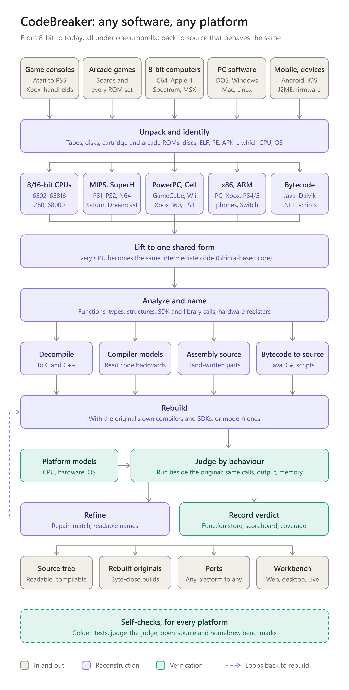

# Any software, any platform

CodeBreaker's aim: take **any** program -- from 8-bit computers and arcade boards to every games
console, PC and phone of today -- back to source that is readable, compiles, and behaves as the
original did. One tool, one pipeline, one way of judging; a platform is what plugs into it.

## The layers

Everything after the CPU front end is shared. A new platform adds pieces to the layers below the
line and nothing above it.

| Layer | What it is | Per platform? |
|---|---|---|
| Unpack | containers: tapes, disks, cartridge and arcade ROM sets, discs, XEX, ELF, PE, NE, LE, APK, IPA, Mach-O | yes: a reader in `formats/` |
| Identify | which CPU, OS, SDK, compiler and runtime made it -- and, per function, whether it was written in assembly or compiled | yes: signatures in `symbols/` |
| CPU front end | the instruction set as SLEIGH, lifted to p-code | yes: a processor spec in `native/decompiler` (upstream Ghidra already has most: 6502, Z80, 68000, MIPS, SuperH, ARM, AArch64, 8051, AVR, PIC, Dalvik -- the work is compiling them in and checking them, not writing them) |
| ---------------- | ---------------- | ---------------- |
| Shared form | p-code, one intermediate code for every CPU | no |
| Analyze and name | functions, types, structures, calls into the SDK and hardware | no (fed by the platform's names) |
| Back to source | in the language it was written in: assembly source for hand-written code (most 8-bit, arcade and early console code), C/C++ for compiled code, source for bytecode | no |
| Rebuild | the platform's own compilers and SDKs, or modern ones | yes: a build profile in `build/` |
| Judge | run beside the original on a model of the platform | yes: a platform model in `emulate/` |

## Where it stands

| Family | CPUs | Platforms | Unpack | CPU spec | Platform model | Judged |
|---|---|---|---|---|---|---|
| x86 | 8086 - x86-64 | DOS, Windows 3.x/95, drivers | yes | yes (x86-64 spec present, unused) | Unicorn: DOS, Win16, Win32, VxD | yes |
| PowerPC | 32/64-bit, VMX128 | Xbox 360, PowerPC images | yes (XEX, STFS, discs, GoD, FATX) | yes (Xenon: VMX128) | own interpreter | yes |
| Bytecode | JVM | Java source to C++03 | n/a | n/a | the JVM | yes |
| 8-bit | 6502 (2A03) | NES | yes (iNES, NES 2.0) | yes (checked: 151/151) | own 6502 interpreter | yes |
| 8-bit | Z80 | Master System, Game Gear, SG-1000 | yes (.sms .gg .sg; Sega mapper) | own table (every opcode, undocumented included) | own Z80 interpreter | yes (WLA-DX source) |
| 8-bit | SM83 | Game Boy, Game Boy Color | yes (.gb .gbc; header, MBC) | own table | own SM83 interpreter | yes (RGBDS source) |
| 16/32-bit | 68000 | Genesis / Mega Drive | yes (.md .bin .gen .smd; header, vectors) | own table (every 68000 instruction) | own 68000 interpreter | yes (Motorola-syntax source) |
| 8/16-bit | 6502, 65816, Z80, 68000, SPC700 | Atari, SNES, Neo Geo, C64, Apple II, Spectrum, MSX, arcade | no | 6502, Z80, 68000 yes | 6502, Z80, 68000 yes | no |
| x86, console | Pentium III | original Xbox (XBE) | yes (as a PE image; kernel imports named) | yes | Unicorn (the 32-bit lane) | yes |
| MIPS, SuperH | R3000, R4300, R5900, SH-2, SH-4 | PS1, N64, PS2, Saturn, Dreamcast, arcade | no | no | no | no |
| PowerPC, Cell | Gekko, Broadway, Xenon, Cell PPU/SPU | GameCube, Wii, Xbox 360, PS3 | no | PPU yes, SPU no | no | no |
| x86-64, ARM | x86-64, ARM7/9, ARMv7, AArch64 | PC 64-bit, GBA, DS, 3DS, Xbox One, PS4/5, phones, Switch | no | no | no | no |
| Firmware | 8051, AVR, PIC, ARM Cortex-M, Xtensa | microcontrollers, BIOS/UEFI, device firmware | no | no | no | no |
| Bytecode | Dalvik, .NET IL, scripts | Android, .NET, Lua and others | no | no | no | no |

## Order of work

1. **Platform-neutral seams first.** Today the platform is often implied (x86, Windows). Make it
   explicit: a platform descriptor (CPU spec, container reader, OS/SDK names, build profile,
   platform model) that every stage asks, so the next platform adds a descriptor, not branches.
2. **One small 8-bit platform end to end** -- the proof that the seams hold: 6502 (NES or Apple II,
   with homebrew and open-source programs as ground truth, as `tools/oss_bench.py` does for C).
   Its source is assembly that rebuilds (ca65), as for DOS and drivers; C only for cc65-built
   programs. Unicorn has no 6502, Z80 or SuperH, so the platform model comes from an open-source
   emulator core, driven the way `emulate/` drives Unicorn.
3. **Arcade**: ROM sets (MAME's set descriptions say which CPU and where each ROM loads) on the
   same 8/16-bit CPUs; Z80 and 68000.
4. **Xbox and Xbox 360 completed**: XEX (native/xex, docs/XEX.md) + the PowerPC already here; the
   original Xbox is x86 already handled -- only the XBE reader and the kernel's imports are new.
5. **64-bit and ARM**: x86-64 PE/ELF, AArch64 ELF/Mach-O; then Android (Dalvik) and iOS.
6. **The rest of the consoles**, family by family: MIPS (PS1, N64, PS2), SuperH (Saturn,
   Dreamcast), Cell (PS3), x86-64 consoles.

Each step is judged the same way as everything else: rebuilt, run beside the original, the same
behaviour -- with open-source and homebrew programs, whose authors' source we have, as the
ground truth for how close the source comes back.
