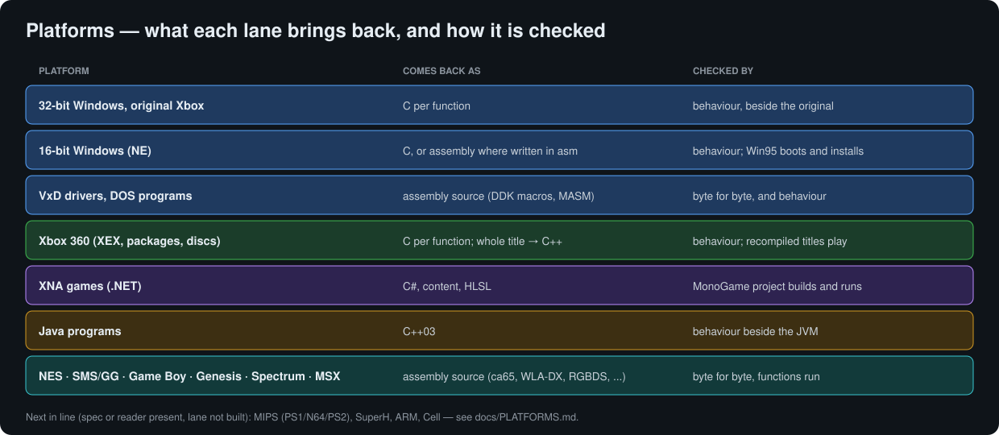

# Any software, any platform

CodeBreaker's aim: take **any** program -- from 8-bit computers and arcade boards to every games
console, PC and phone of today -- back to source that is readable, compiles, and behaves as the
original did. One tool, one pipeline, one way of judging; a platform is what plugs into it.

## The layers

Everything after the CPU front end is shared. A new platform adds pieces to the layers below the
line and nothing above it.

| Layer | What it is | Per platform? |
|---|---|---|
| Unpack | containers: tapes, disks, cartridge and arcade ROM sets, discs, XEX, ELF, PE, NE, LE, APK, IPA, Mach-O | yes: a reader in `formats/` |
| Identify | which CPU, OS, SDK, compiler and runtime made it -- and, per function, whether it was written in assembly or compiled | yes: signatures in `symbols/` |
| CPU front end | the instruction set as SLEIGH, lifted to p-code | yes: a processor spec in `native/decompiler` (upstream Ghidra already has most: 6502, Z80, 68000, MIPS, SuperH, ARM, AArch64, 8051, AVR, PIC, Dalvik -- the work is compiling them in and checking them, not writing them) |
| ---------------- | ---------------- | ---------------- |
| Shared form | p-code, one intermediate code for every CPU | no |
| Analyze and name | functions, types, structures, calls into the SDK and hardware | no (fed by the platform's names) |
| Back to source | in the language it was written in: assembly source for hand-written code (most 8-bit, arcade and early console code), C/C++ for compiled code, source for bytecode | no |
| Rebuild | the platform's own compilers and SDKs, or modern ones | yes: a build profile in `build/` |
| Judge | run beside the original on a model of the platform | yes: a platform model in `emulate/` |

## Where it stands

| Family | CPUs | Platforms | Unpack | CPU spec | Platform model | Judged |
|---|---|---|---|---|---|---|
| x86 | 8086 - x86-64 | DOS, Windows 3.x/95, drivers | yes | yes (x86-64 spec present, unused) | Unicorn: DOS, Win16, Win32, VxD | yes |
| PowerPC | 32/64-bit, VMX128 | Xbox 360, PowerPC images | yes (XEX, STFS, discs, GoD, FATX) | yes (Xenon: VMX128) | own interpreter | yes |
| Bytecode | JVM | Java source to C++03 | n/a | n/a | the JVM | yes |
| Bytecode | .NET CIL | XNA games (Xbox 360 Indie / Arcade, PC): `xna`, then `xna port` | yes (STFS, folders; XNB content, XACT banks) | n/a (ILSpy decompiles CIL to C#) | MonoGame (xna/runtime: content incl. Xbox byte order for buffers and textures, effects recovered as HLSL from Xenos microcode and compiled by mgfxc, players, storage, XACT, the controller with the keyboard; generated XNA API stubs; de4dot for obfuscated assemblies) | builds and runs (no per-function judge) |
| 8-bit | 6502 (2A03) | NES | yes (iNES, NES 2.0) | yes (checked: 151/151) | own 6502 interpreter | yes |
| 8-bit | 6502 (6507) | Atari 2600 | yes (raw .a26 / .bin: 2 KB, 4 KB, and 8 / 16 / 32 KB with F8 / F6 / F4 bank switching by the usual hotspots; the 13-bit address mirrors folded) | own table (the NMOS 6502) | own 6502 interpreter over the 6507's map: 13 address lines, 128 bytes of RAM with the stack in its mirror, TIA and RIOT registers named and logged, bank switches logged | yes (dasm source: `ORG`/`RORG` per bank, TIA and RIOT names, `.w` for absolute zero-page forms; CodeBreaker's own dasm-syntax assembler rebuilds it) |
| 8-bit | 6502 (Sally) | Atari 7800 | yes (.a78 header v1-4; linear ROMs of 4-48 KB at the top of memory, SuperGame banks of 16 KB; Activision, absolute, banked-RAM, POKEY and YM2151 boards not modelled, 2600 mode not modelled) | own table (the NMOS 6502) | own 6502 interpreter over the 7800's map: TIA, MARIA and RIOT registers named and logged, 4 KB RAM with its zero-page and stack windows, SuperGame bank select logged | yes (dasm source, the header as data; the 6502C's HALT stalls are not modelled) |
| 8-bit | 65SC02 | Atari Lynx | yes (.lnx cartridges, BS93 `.o` objects; the cartridge's encrypted first stage is decrypted and the loaders run to find what they load) | own table (the NMOS set and the 65SC02's BRA, STZ, TRB/TSB, PHX/PHY/PLX/PLY, INC A/DEC A, `(zp)`, `JMP (abs,X)`) | own 65SC02 interpreter (Suzy and Mikey registers named and logged) | yes (ca65 source, `ld65` configuration) |
| 8-bit | HuC6280 (65C02 and Hudson's additions) | TurboGrafx-16 / PC Engine | yes (.pce .tg16 .sgx HuCards in 8 KB banks, with or without a 512-byte copier header; the US bit-reversed dumps, the largest cards' mappers and the CD-ROM system are not modelled) | own table (the 65C02 set, the Rockwell bit instructions RMBn SMBn BBRn BBSn, and the block transfers TII TDD TIN TIA TAI, TAM / TMA, ST0 ST1 ST2, SET, SAX SAY SXY, CLA CLX CLY, CSL / CSH, TST, BSR) | own HuC6280 interpreter (the 65C02 core with page zero at $2000 and the stack at $2100) over the console's map: the eight mapping registers (MPR0-7) and 8 KB banks, RAM at bank $F8, VDC / VCE / PSG / timer / joypad / interrupt registers named and logged (the VDC data port under the register ST0 selected) | yes (ca65 source `.setcpu "HuC6280"`, `ld65` configuration: one segment per 8 KB bank, linked where the code maps it, found by following `LDA #n` / `TAM`; CodeBreaker's own ca65-syntax assembler rebuilds it) |
| 16-bit | 65C816 | Super Nintendo | yes (.sfc .smc, with or without a 512-byte copier header; LoROM or HiROM found from the internal header at $7FC0 / $FFC0 by its checksum pair, map mode and vectors; ExHiROM and the coprocessors are not modelled; the SPC700 sound program stays data) | own table (all 256 opcodes; the immediate operands change length with the M and X flags, which are followed through REP, SEP and `CLC; XCE`) | own 65C816 interpreter (native and emulation mode, 8- and 16-bit registers, direct page, banks, block moves, decimal ADC / SBC) over the 5A22's map: LoROM / HiROM mirrors, 128 KB of RAM, PPU / APU port / WRAM port / joypad / CPU / DMA registers named and logged, DMA run (each byte a logged register access), HDMA logged | yes (ca65 source `.p816` with `.a8` / `.a16` / `.i8` / `.i16` where an immediate's width changes, `ld65` configuration: one segment per bank; a function's address carries the widths it starts in) |
| 8-bit | Z80 | Master System, Game Gear, SG-1000, SC-3000 | yes (.sms .gg .sg .sc; Sega mapper on the Master System and Game Gear, none on the SG-1000 / SC-3000) | own table (every opcode, undocumented included) | own Z80 interpreter | yes (WLA-DX source) |
| 8-bit | Z80 | ZX Spectrum, MSX | yes (.sna .z80 .tap; .rom up to 48 KB) | own table | own Z80 interpreter | yes (sjasmplus / pasmo source) |
| 8-bit | Z80 | ColecoVision | yes (.col, or .rom/.bin with the $AA55 header; up to 32 KB, larger mappers refused) | own table | own Z80 interpreter with the console's memory map (BIOS stubbed and its calls logged by name, RAM at $6000, VDP and sound ports logged) | yes (sjasmplus / pasmo source) |
| 8-bit | Z80 | Amstrad CPC | yes (.dsk standard and extended: the AMSDOS directory, the best binary; .sna 64 KB snapshots; .bin with an AMSDOS header; tapes not yet) | own table | own Z80 interpreter with the firmware jumpblock stubbed and its calls logged by name, gate array / CRTC / PPI ports logged with all 16 bits | yes (sjasmplus / pasmo source) |
| 8-bit | SM83 | Game Boy, Game Boy Color | yes (.gb .gbc; header, MBC) | own table | own SM83 interpreter | yes (RGBDS source) |
| 16/32-bit | 68000 | Genesis / Mega Drive | yes (.md .bin .gen .smd; header, vectors) | own table (every 68000 instruction) | own 68000 interpreter | yes (Motorola-syntax source) |
| 16/32-bit | 68000 (+ Z80 sound) | Neo Geo (AES / MVS) | yes (the P-ROM: plain, word-swapped, or the even and odd halves joined; `.neo` containers, whose M-ROM is kept; "NEO-GEO" header at $100, the four callbacks of its jump table, vectors; the second megabyte in the $200000 bank window) | own table (the Genesis's) | own 68000 interpreter with the Neo Geo's memory map: work and palette RAM, the system ports and memory card logged, the LSPC's VRAM modelled, the BIOS stubbed with each call logged (SYSTEM_IO, FIX_CLEAR ...) | yes (Motorola-syntax source; the Z80 M-ROM comes back as sjasmplus / pasmo source, not judged) |
| 16/32-bit | 68000 x 2 | Sega CD / Mega-CD | yes (.iso 2048- and .bin 2352-byte sectors; the boot header, the main CPU's security code and IP at $FF0000, the sub CPU's SP at $6000 with its jump table; only the 32 KB system area) | own table (the Genesis's) | own 68000 interpreter with each CPU's memory map: the Genesis's with the gate array and word RAM for the main CPU; PRG-RAM, word RAM, PCM and the gate array for the sub CPU, whose CD BIOS calls are logged | yes (Motorola-syntax source, one file holding both programs at their own addresses) |
| 32-bit | SH-2 x 2 (SH7604: big-endian, 16-bit instructions, delay slots, PC-relative constant pools, MAC, divide unit) + 68000 | Sega 32X | yes (.32x; the Genesis header, the 32X header at $3C0: the SH-2 program's ROM offset and length, the master and slave start addresses and vector bases; the program is copied to SDRAM at $06000000) | own table (every SH-1 and SH-2 instruction, GNU as syntax) | own SH-2 interpreter with the SH-2s' memory map: SDRAM, the cartridge window and the frame buffer compared, the 32X system and VDP registers and the SH7604's own (the divide unit divides) logged; the 68000 side runs in the 68000 interpreter | yes (GNU as source for the SH-2 program, `.long`/`.word`/`.asciz` data, the PC-relative constants named; the 68000 side as Motorola-syntax source, the Genesis writer's) |
| 32-bit | SH-4 (SH7750, little-endian; FPU, banked registers, store queues) | Sega Dreamcast | yes (.gdi with its track files, .cdi searched for its boot track, .iso, raw .bin; IP.BIN field by field, 1ST_READ.BIN at $8C010000, scrambled ones descrambled) | own table (the SH-2's, little-endian, plus the FPU and system instructions) | own SH-4 interpreter (single/double FPU, pair moves, FIPR/FTRV, SR.RB banks, RTE, store queues; the P4 registers held and logged; exception flags, rounding modes, the MMU and caches not modelled) with the Dreamcast's memory map: main RAM, video and sound RAM compared, the Holly, Maple, G1/GD-ROM, G2, PowerVR2 and AICA registers logged, the BIOS's system calls stubbed and logged | yes (GNU as source, one file with the header, IP.BIN and the program each at its own address) |
| 32-bit | SH-2 x 2 (SH7604) | Sega Saturn | yes (.iso 2048-byte sectors, raw .bin 2352-byte sectors, .cue; the IP.BIN header field by field, the four area-code entries and the initial program at $06002000, the first program from the root directory at its load address, usually $06004000) | own table (the 32X's) | own SH-2 interpreter with the Saturn's memory map: both work RAMs, VDP1 and VDP2 video memory, colour RAM and sound RAM compared, the SMPC, SCU, VDP1, VDP2, CD block, SCSP and A-bus registers logged, the BIOS stubbed | yes (GNU as source, one file with the header, IP.BIN and the program each at its own address) |
| 8-bit | 6502 (Sally) | Atari 5200 | yes (`.a52` or a raw `.bin` of 4, 8, 16 or 32 KB ending at $BFFF; the start address in the last two bytes, with the two flag bytes before it; 40 KB banked cartridges not modelled) | own table (the NMOS 6502) | own 6502 interpreter over the 5200's map: 16 KB RAM, GTIA, ANTIC and POKEY registers named and logged, the BIOS window reads RTS | yes (dasm source; `reach --judge`: Curse of the Lost Miner 100 of 100 verified) |
| 32-bit | 68000 (+ Tom and Jerry: the GPU and DSP RISC cores stay data) | Atari Jaguar | yes (`.j64` / `.jag` / `.rom` cartridges at $800000, the boot signature, the header at $400 and the start address; COFF executables `.cof` / `.abs`, sections loaded where they say) | own table (the Genesis's) | own 68000 interpreter over the Jaguar's map: 2 MB DRAM, the GPU and DSP RAM, Tom's and Jerry's registers named and logged | yes (Motorola-syntax source; `reach --judge`: JaguarDemos 28 of 28 verified) |
| 16-bit | NEC V30MZ (80186-class x86) | Bandai WonderSwan, WonderSwan Color | yes (`.ws` / `.wsc`: the footer, its reset far jump and checksum, the ROM ending at $FFFFF; bank registers and ROMs over 896 KB not modelled) | Capstone's 16-bit x86 | Unicorn's 16-bit x86 over 1 MB with internal RAM, the I/O ports named and logged | yes (NASM source found out in rounds against NASM; the code segment the reset jump names is followed, the rest is data) |
| 32-bit | ARM60 (ARMv3, big-endian) | 3DO | yes (`.iso` with the Opera filesystem: the root directory's LaunchMe; a bare AIF executable; the 26-bit mode not modelled) | own table (the ARM7TDMI's ARM state) | own ARM interpreter with `Bus::set_big_endian`: main RAM holding the image, Madam and Clio logged, the operating system's SWIs logged | yes (GNU as source: every word is its value, the image written for its words reversed) |
| 16/32-bit | 68000 (Philips 68070) | Philips CD-i | yes (a disc image found by its Disc Label, the CD-RTOS modules in it, or a module file; the filesystem is not read) | own table (the Genesis's) | own 68000 interpreter: the modules placed from $10000, free RAM at $100000, the video chip and slave processor logged, each `TRAP #0` made a logged stub call | yes (Motorola-syntax source; a real module, CDI_FROG, rebuilds identical) |
| 8-bit | Motorola 6809 | Vectrex | yes (`.vec` / `.bin` / `.gam` up to 32 KB; the `g GCE` header, title lines and the program after them; banked cartridges not read) | own table (every opcode of the three pages) | own 6809 interpreter over the Vectrex's map: cartridge ROM, 1 KB RAM, the VIA 6522 logged, the system ROM as stubs whose entries are named and logged | yes (6809 source, CodeBreaker's own assembler or lwasm; E-SRG and the tutorial cartridges rebuild identical) |
| 32-bit | NEC V810 | Nintendo Virtual Boy | yes (`.vb` / `.vboy`, a power-of-two ROM of 16 KB to 16 MB linked at $07000000; the header, the vector slots and the reset slot are read) | own table (every bit pattern: the 16-bit and 32-bit formats, the floating-point and bit-string instructions; 150,000+ round-trip checks) | own V810 interpreter over the console's 27-bit map: VIP memory and registers, VSU, hardware control registers (all named and logged), work RAM, cartridge ROM | yes (GNU-style V810 source, CodeBreaker's own assembler; `hi()` / `lo()` pairs name ROM data and hardware registers; 4 VUEngine demos rebuild identical, 522 functions verified) |
| 16-bit | General Instrument CP1610 | Mattel Intellivision | yes (Intellicart / jzIntv `.rom`: segments, CRC-16 and the tables after them; raw `.int`; the header at $5000 names the program's start) | own table (the 10-bit decles, SDBD, every addressing mode; 60,000+ round-trip checks) | own CP1610 interpreter over the word-addressed map: STIC and PSG logged by register name, scratch and system RAM, GRAM, the executive ROM as stubs whose entries are logged | yes (as1600-style source with SEGMENT / ROMTAIL directives, CodeBreaker's own assembler; Space Versus rebuilds identical, 54 functions verified) |
| 8/16-bit | 6502, 65816, Z80, 68000, SPC700 | 8-bit Atari, C64, Apple II, arcade | no | 6502, Z80, 68000 yes | 6502, Z80, 68000 yes | no |
| x86, console | Pentium III | original Xbox (XBE) | yes (as a PE image; kernel imports named) | yes | Unicorn (the 32-bit lane) | yes |
| 32-bit | MIPS R3000A (MIPS I, little-endian; GTE decoded) | PlayStation | yes (PS-X EXE; header, load address, entry) | own table (every MIPS I instruction, COP0, the GTE's commands) | own R3000A interpreter (delay slots, load delay, BIOS calls and devices logged; the GTE's registers, not its commands) | yes (GNU as source) |
| 64-bit | MIPS R4300i (MIPS III: 64-bit registers, big-endian; FPU, TLB, branch likely) | Nintendo 64 | yes (.z64 .v64 .n64 normalised; the 64-byte header, the boot code IPL3 as data, the program at the entry point the boot code copies it to, CIC chip and checksums) | own table (the R3000A's variant: every MIPS III instruction the R4300i has, COP0 with TLBR/TLBWI/TLBWR/TLBP/ERET, COP1 single and double) | own R4300i interpreter (64-bit registers, delay slots, branch likely, the TLB, the FPU with its rounding modes; RDRAM, the cartridge and a PI DMA, the RCP's registers logged; the RSP and RDP are not run) | yes (GNU as source, big-endian) |
| 64-bit | MIPS R5900 (the PlayStation 2's Emotion Engine: MIPS III, 128-bit registers, the multimedia instructions, little-endian; COP2 VU0 macro mode decoded, its first function group) | PlayStation 2 | yes (an EE `.elf`, or an `.iso` whose SYSTEM.CNF BOOT2 program is one; the VU and IOP code is data) | own table (`Variant::R5900`; `decompile/mips_ext` for VU0) | own interpreter (`emulate/mips_le` + `emulate/ee`): 32 MB RAM, scratchpad, the EE's unit registers named and logged, kernel system calls logged; MMI multiplies, VU0 arithmetic and the TLB not run | yes (the ELF whole: headers, sections, symbols; GNU as syntax) |
| 32-bit | MIPS Allegrex (the PSP: MIPS32 + the VFPU, little-endian) | PSP | yes, unencrypted only (`.elf`, `.prx`, `EBOOT.PBP`; a `~PSP` module is recognised and recorded as not handled; imports named by NID from pspsdk's published lists) | own table (`Variant::Allegrex`; the VFPU subset in `decompile/mips_ext`) | own interpreter (`emulate/mips_le` + `emulate/allegrex`): 32 MB RAM, VRAM, hardware blocks named, imports logged by name; the VFPU and the GE not run | yes (the file whole; a PBP's other files and a PRX's relocations as data) |
| MIPS | R5900 | PS2, arcade | no | no | no | no |
| 32-bit | PowerPC 750 family, big-endian: Gekko, Broadway, Espresso (the same instructions, with Gekko's paired singles: `ps_add`, `ps_madd`, `ps_merge00` ..., `psq_l` / `psq_st` and the quantization registers) | GameCube, Wii, Wii U | yes (a DOL: 7 text and 11 data sections, the entry point; a PowerPC ELF: devkitPPC's output; a Wii U RPX / RPL: an ELF with compressed sections, read decompressed; the console is told by what the program touches: MEM2 or the Hollywood registers mean the Wii) | own table (every 750 instruction, the simplified mnemonics, the paired singles; GNU as syntax) | own PowerPC interpreter (the Xbox 360's, with paired singles, the quantization registers and the memory-mapped hardware registers logged): the command processor, pixel engine, video, processor interface, memory, DSP, disc, controllers, external devices and audio blocks of the GameCube; the Wii's mailbox (IPC) and Hollywood registers; the Wii U's Latte window; they are named, not emulated | yes (GNU as source: the header field by field, the sections at their addresses, hardware registers by name, `name@ha` / `name@l`; an ELF's symbol table names its functions) |
| 64-bit, Cell | Cell PPU, SPU | PS3 (the Xbox 360 is the PowerPC row above) | no | PPU yes, SPU no | no | no |
| 32-bit | ARM7TDMI (ARMv4T: ARM and Thumb state) | Game Boy Advance | yes (.gba; header, logo, checksum, entry branch, ROM at $08000000) | own table (every ARMv4T ARM and Thumb instruction) | own ARM7TDMI interpreter (both states, banked modes, memory map, BIOS calls logged) | yes (GNU as `.syntax unified` source) |
| 32-bit | ARM946E-S (ARMv5TE: ARM and Thumb state, BLX, CLZ, saturating and 16-bit multiplies, LDRD/STRD, PLD, coprocessor 15) + ARM7TDMI | Nintendo DS | yes (.nds; header, logo and CRC-16s, both programs at their RAM addresses, FNT, FAT, overlay tables, banner) | own table (the ARMv4T set and the ARMv5TE additions, selected by an `Arch` parameter) | own ARM interpreter, `System::Nds9` and `System::Nds7` (ARMv5 interworking loads, CP15 and the TCMs, main RAM, shared WRAM, I/O registers and BIOS calls logged) | yes (GNU as `.syntax unified` source, one file with a part for each processor) |
| 32-bit | ARM11 MPCore (ARMv6K: ARM state, the ARMv6 integer additions and the VFP; user mode) | Nintendo 3DS | yes (`.3dsx`: header, the three segments, absolute relocations; devkitARM's ELF linked at $00100000; an encrypted `.cia` / `.3ds` is recognised and refused) | own table (`Arch::V6K`: the ARMv5TE set and `decompile/arm_ext`'s rows: REV, UXTAB, LDREX, SSAT, SMMUL, UMAAL, the parallel add and subtract families, VLDR, VADD.F32 ...; Thumb is decoded without the ARMv6 additions) | own ARM interpreter (`System::N3ds`: paged memory with the program loaded at $00100000, the I/O, video and kernel-page windows logged, Horizon SVCs logged by name, the integer additions and the VFP's moves, arithmetic, compares and conversions run) | yes (GNU as `.syntax unified` source, the file whole in file order) |
| x86-64, ARM | x86-64, ARM9, ARMv7, AArch64 | PC 64-bit, DS, Xbox One, PS4/5, phones, Switch | no | no | no | no |
| Firmware | 8051, AVR, PIC, ARM Cortex-M, Xtensa | microcontrollers, BIOS/UEFI, device firmware | no | no | no | no |
| Bytecode | Dalvik, .NET IL, scripts | Android, .NET, Lua and others | no | no | no | no |

## Order of work

1. **Platform-neutral seams first.** Today the platform is often implied (x86, Windows). Make it
   explicit: a platform descriptor (CPU spec, container reader, OS/SDK names, build profile,
   platform model) that every stage asks, so the next platform adds a descriptor, not branches.
2. **One small 8-bit platform end to end** -- the proof that the seams hold: 6502 (NES or Apple II,
   with homebrew and open-source programs as ground truth, as the OSS benchmark does for C).
   Its source is assembly that rebuilds (ca65), as for DOS and drivers; C only for cc65-built
   programs. Unicorn has no 6502, Z80 or SuperH, so the platform model comes from an open-source
   emulator core, driven the way `emulate/` drives Unicorn.
3. **Arcade**: ROM sets (MAME's set descriptions say which CPU and where each ROM loads) on the
   same 8/16-bit CPUs; Z80 and 68000.
4. **Xbox and Xbox 360 completed**: XEX (native/xex, docs/XEX.md) + the PowerPC already here; the
   original Xbox is x86 already handled -- only the XBE reader and the kernel's imports are new.
5. **64-bit and ARM**: x86-64 PE/ELF, AArch64 ELF/Mach-O; then Android (Dalvik) and iOS.
6. **The rest of the consoles**, family by family: MIPS (PS1 done: R3000A; N64 done: R4300i; PS2 done: R5900; PSP done: Allegrex), SuperH (32X, Saturn and Dreamcast done: SH-2, SH-4),
   PowerPC 750 (GameCube, Wii and Wii U done), Cell (PS3), x86-64 consoles.

Each step is judged the same way as everything else: rebuilt, run beside the original, the same
behaviour -- with open-source and homebrew programs, whose authors' source we have, as the
ground truth for how close the source comes back.
